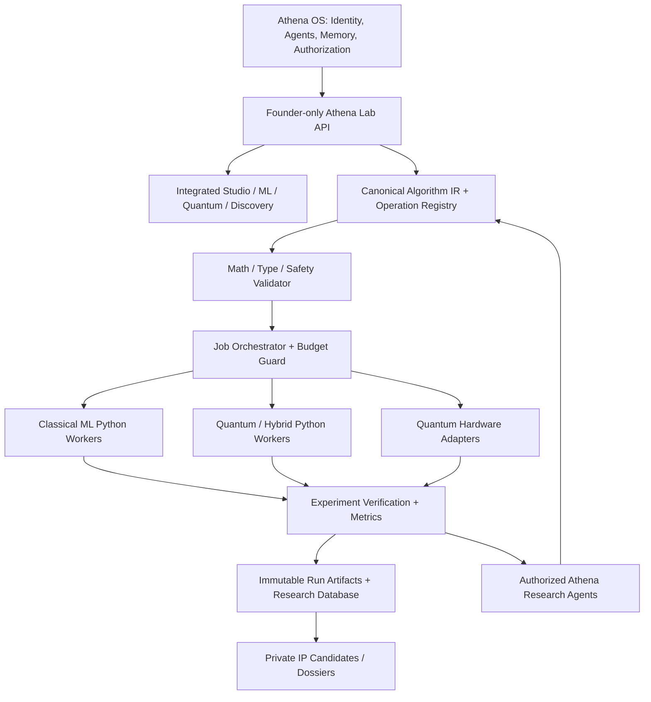

# ATHENA LAB — MASTER SPECIFICATION

**Project:** Athena Lab — ML × Quantum Algorithm Research Environment  
**Parent product:** Athena Autonomous AI Operating System  
**Document type:** Canonical product, research, architecture, and implementation specification for Codex  
**Version:** 1.0 (initial master specification)  
**Date:** 12 November 2026  
**Audience:** Founder(s), Codex implementation agents, technical collaborators, research reviewers  
**Status:** **Specification / proposed architecture**. This document is **not** evidence that the described features have been implemented, validated, or deployed.

> **Codex operating instruction:** Treat this document as the intended design and acceptance contract for Athena Lab. Inspect the actual Athena repository before coding. Existing working functionality, security boundaries, and repository conventions must be preserved. Implement one approved phase at a time, test it, and report what is *real*, *simulated*, *mocked*, *planned*, and *blocked*. Never substitute attractive placeholders for mathematical or hardware correctness.

---

## 0. Executive definition

Athena Lab is a **private, founder-owned research module inside Athena**, designed to create, dissect, edit, combine, optimize, evaluate, and document **classical machine-learning, quantum-computing, and hybrid algorithms**. It is intended to become an **algorithm R&D and invention engine**, not merely a teaching tool, static math visualizer, or standalone commercial SaaS offering.

Its defining interaction is:

1. Construct or import an algorithm as a visual, executable mathematical graph.
2. Zoom from the complete algorithm to individual operations, equations, gates, tensors, and intermediate states.
3. Change a parameter **or a valid mathematical/architectural operation**, and compute what changes downstream.
4. Combine compatible classical and quantum components into trainable or otherwise executable hybrid workflows.
5. Compare variants against strong baselines under realistic statistical, computational, and hardware constraints.
6. Use Athena's agents to propose, implement, and test bounded research hypotheses.
7. Preserve a reproducible evidence package for independent scientific review and possible confidential commercialization.

**North star:** Make algorithms inspectable, mutable, executable, falsifiable, reproducible, and—only when justified by evidence—commercially useful.

### 0.1 What Athena is, and what Athena Lab is not

| System | Purpose | Users | Revenue / value |
|---|---|---|---|
| **Athena OS** | Autonomous agents for planning, device/app tasks, and business-process automation | Athena's authorized users and business customers | Business automation services / software |
| **Athena Lab** | Internal mathematical research and algorithm-development environment | Founder(s) and explicitly authorized research collaborators | Potential IP and specialized algorithms produced by the lab; internal performance improvements |

Athena Lab **must not** be presented as the same commercial offering as Athena OS. It may reuse Athena's orchestration, memory, permissions, agent workforce, and deployment infrastructure, but founder research is isolated from business customer data and operations. **Licensing the lab UI itself is not the default business model.** The primary proposed commercial outputs are **validated algorithmic technologies** (license, hosted API, field-specific/exclusive rights, or negotiated IP sale), not access to a general-purpose lab SaaS.

### 0.2 Truth, maturity, and success

- **Design intent is not a working feature.** Historical UI mockups and early HTML demos are illustrative.
- **Algorithm generation is not proof of originality.** Research novelty, patentability, commercial advantage, and ownership require separate review.
- **Quantum execution is not quantum advantage.** A hybrid model must be compared against strong classical and quantum-inspired baselines.
- **Real-time means appropriate latency.** Cheap simulator operations may update during a slider drag. Retraining, noisy sampling, and QPU jobs require visibly asynchronous recomputation.
- **A 10/10 result is earned, not declared.** Technical correctness, independent verification, customer evidence, and commercial agreements are external gates.

---

## 1. Product principles and non-negotiables

1. **Mathematics is the source of truth.** The graph/IR and verified compute backends own equations and numbers. LLM text never becomes an authoritative numerical result without execution and validation.
2. **One algorithm, synchronized representations.** Canvas, equation view, code view, execution trace, and experiment record reference the *same* versioned algorithm definition.
3. **Change one thing, trace what changes.** Every edit produces a dependency-aware impact trace, highlighting invalidated downstream computations and freshly computed results.
4. **Composition must be type safe.** Respect shape, dtype, units, device domain, qubit register, measurement semantics, differentiability, and execution constraints.
5. **Inspectability at multiple levels.** Whole pipeline → module → layer/circuit → gate/operator → equation/parameter → numerical value.
6. **Scientific integrity.** Distinguish hypothetical, simulated, noisy simulated, reconstructed/inferred, and physically measured results; preserve provenance and uncertainty.
7. **Research before performance claims.** No claimed improvement without fair baselines, relevant metrics, appropriate budgets, repeated tests, and leakage control.
8. **Founder-only by default.** The lab is not accessible to ordinary Athena OS clients. Explicit collaborator access is scoped, revocable, and audited.
9. **AI is a copilot, not an oracle.** Agents propose hypotheses, read grounded evidence, call tools, and report errors/limitations; they do not fabricate derivations or experimental outcomes.
10. **Resource safety.** All jobs have caps on memory, time, shots, estimated spend, concurrency, and retries; paid hardware requires confirmation.
11. **Modularity.** Prefer a JS/TS Athena-facing orchestration surface plus isolated Python numerical workers. Inspect existing code before choosing frameworks or refactoring.
12. **Private by design.** Keep research IP, datasets, code, credentials, unpublished results, and customer data in distinct permission and storage domains.
13. **Reversibility.** Every meaningful graph change supports undo/redo or version branching, with a reproducible version identifier.
14. **Graceful degradation.** Local simulation must work when a QPU is unavailable; hardware-specific features must report limits instead of silently faking execution.

### 1.1 Explicit non-goals for initial implementation

- Replacing Athena OS or rebuilding its agent infrastructure from scratch.
- Granting business customers access to founder research by default.
- Training a frontier LLM from scratch.
- Claiming a universal quantum speedup or automatic patentable invention.
- Implementing every ML model and quantum protocol before one vertical workflow works.
- Building a new quantum physics simulator when maintained libraries can perform the underlying computation.
- Running arbitrary agent-generated code directly inside the OS API process.
- Promising instant results from physical QPUs, or exposing full device statevectors as if physically observed.
- Treating post-quantum cryptography and quantum key distribution as the same technology.

---

## 2. Intended users and research workflows

### 2.1 Roles

- **Founder / Research Owner:** Full access, approves paid hardware and privileged agent actions, defines research priorities, owns source artifacts and commercial decisions.
- **Research Collaborator:** Explicit invitation; scoped projects, runs, datasets, notebooks, and export privileges; cannot access unrelated founder work or Athena OS customer data.
- **Read-only Reviewer:** Access to selected technical dossiers and reproducibility packages, not mutable source graphs or credentials.
- **Athena Research Agent:** Narrow, revocable tool capabilities; jobs are attributed to an agent, policy, and human approval when required.
- **Athena Business Customer:** **No lab access** unless an entirely separate, explicit product decision and authorization process is made.

### 2.2 Principal journeys

**A. Visual experiment.** Select a classical model, open graph, inspect the loss, change learning rate, compare optimization paths, revert to baseline, and save a run.

**B. Quantum experiment.** Build a two-qubit circuit, inspect amplitudes and entanglement in simulation, add noise and finite-shot sampling, optionally submit a compatible compiled circuit to real hardware, then compare the results.

**C. Hybrid synthesis.** Connect normalized features to a quantum embedding, parameterized circuit, measurement/expectation, and classical predictor. Verify port compatibility, train on a small dataset, inspect gradients, compare against classical baseline.

**D. Mathematical mutation.** Substitute a valid operator or circuit layer; Athena validates mathematical and runtime constraints, recompiles the impacted graph, recomputes/retrains as needed, and shows A/B deltas.

**E. Autonomous discovery.** Give a scoped hypothesis and budget. Agents propose modifications, screen candidates, execute controlled tests, record failures and evidence, and surface candidates for human review.

**F. Research collaboration.** Export a reproducible, reviewable dossier with verified results, methods, environment, limitations, and selective confidential disclosures.

**G. Commercialization.** If a candidate survives scientific and customer evaluation, create an IP record, technical acceptance criteria, deployment package, and proposed licensing pathway. This is **not** an automatic conclusion from high benchmark scores.

---

## 3. Detailed feature specification — actual lab

### 3.1 Navigation / information architecture

Default navigation:

- **Integrated Algorithm Studio** — primary home; unified classical/quantum/hybrid graph and live impact.
- **ML Lab** — classical-only algorithms, models, datasets, training, interpretability.
- **Quantum Lab** — circuits, operators, state/noise simulation, gate-level inspection.
- **Hybrid Composer** — built-in interoperable classical–quantum blocks and hybrid templates; may share the Studio canvas engine.
- **Discovery Mode** — agent-led bounded hypothesis testing, mutation search, ranking, and ablations.
- **Experiments / Results** — runs, baselines, comparison reports, hardware provenance.
- **Research Notebook** — linked equations, notes, charts, code, experiment summaries, citations.
- **Hardware Console** — providers, backend metadata, simulation/hardware modes, queues, spend, result history.
- **Quantum Security Lab** — BB84/E91 and other quantum-protocol simulations, with separate post-quantum crypto workflows.
- **Algorithm Library** — templates, mathematical operators, reusable research components.
- **IP / Research Repository** — private candidates, novelty notes, provenance, export packages.
- **Settings / Resources** — approved accounts, hardware spend limits, storage, secrets, worker resources.

Avoid inconsistent naming between "Integrated Lab" and "Algorithm Studio". The canonical primary workspace label is **Integrated Algorithm Studio**.

### 3.2 Integrated Algorithm Studio (highest-priority UI)

**Layout** (desktop first; phone-aware):

- **Top bar:** Workspace/project, experiment branch, simulation/hardware status, backend, save/run, global Athena search/assistant, collaborator scope.
- **Left sidebar:** navigation and searchable **block palette**, with categories and templates.
- **Central expandable canvas:** directed graph with typed ports, groups/subgraphs, custom operations, collapse/expand, pan/zoom, circuit detail overlay, branch comparison.
- **Right inspector:** contextual tabs **Overview | Mathematics | Parameters | Code | Impact | Constraints | Provenance**.
- **Bottom panel:** coordinated **Visualizations | Step Execution | Mathematical Flow | Training | Results | Logs**.
- **Timeline/playback:** play, pause, step forward/back, breakpoint, execution stage, current intermediate outputs, speed for recorded simulation steps.
- **Compare mode:** pin baseline branch; display before/after formulas, model outputs, loss, gradients, cost and uncertainty with run IDs.
- **A/B split view:** two structural variants can be executed under comparable resources and evaluated side by side.
- **Contextual AI hints:** marked as AI-generated, dismissible, anchored to a graph node or verified calculation; do not obstruct work.

**Zoom levels:** (1) whole algorithm; (2) subgraph/module; (3) network layer / quantum circuit; (4) gate, tensor operation, equation and numerical intermediates. Zooming must not create independent mathematical definitions.

**Mobile behavior:** Stack canvas and inspectors, long-press to add operations, tap/select typed port to connect, inspector as bottom sheet, accessible parameter editing, responsive charts. Heavy computation is executed remotely; no assumption of a mobile-local QPU.

**Accessibility:** keyboard navigation where practical, color-independent operation-type labels, readable math fonts, clear errors, reduced-motion preference, responsive contrast.

### 3.3 Machine Learning Lab

**Core models (incremental):** linear/logistic regression; small MLP; later convolutional networks, tree-based models, dimensionality reduction and selected optimization methods. New models must enter through the same IR contracts rather than one-off UI implementations.

**Data:** CSV/tabular import, synthetic generators, train/validation/test separation, feature previews, normalization/standardization, missing-value handling and leakage checks; later controlled loaders for domain-specific data. Store dataset identity/version/hash and approved access.

**Training:** loss functions, optimizers, learning rates, epochs/batches, early stopping, seeds, weight initialization, execution budget, CPU/GPU selection where supported.

**Inspect:** weights/biases, activation functions, layer input/output tensors, predictions, forward and backward pass, derivative chain, gradient norms, loss landscape (where computationally reasonable), convergence curves, decision boundary, sensitivity and error analysis.

**Actions:** pause/step training where engine supports it, edit a parameter, change a layer/activation, branch and retrain, compare metrics, export code and provenance.

**Correctness:** a graph edit that changes model topology marks previous trained weights/results stale; never display an old loss curve as the new model's training result.

### 3.4 Quantum Computing Lab

**Circuit construction:** qubit registers, initialization, standard gates H/X/Y/Z, Rx/Ry/Rz, CNOT/CZ, measurements, barriers (as appropriate), parameterized layers, reusable subcircuits, observables, circuits and schedules supported by backend capabilities.

**Simulator views:** complex state amplitudes, measurement probabilities, statevector for pure small circuits, density matrix/mixed-state representations, reduced one-qubit Bloch vectors, entanglement metrics with correct assumptions, expectation values, circuit depth/gate counts, shots and sampled counts.

**Noise and realism:** ideal simulation, configurable noise channels, finite-shot sampling, backend-specific compilation constraints, transpilation summary and error-mitigation descriptions when implemented. Results show backend, number of shots, seed when applicable, noise model, confidence/uncertainty and calibration context.

**Mathematical dissection:** matrix form for supported gates, tensor product / composition order, action on quantum state, unitary and Hermitian checks, parameter-shift or supported alternate gradient methods, Born-rule probabilities, measurement collapse semantics.

**Quantum experiment templates:** Bell pair, superposition/interference, Grover-like search where supported, QFT learning module, parameterized variational circuits, quantum feature maps, quantum kernels, and selected optimization algorithms. These are progressively implemented, not promised in V1.

**Truth constraint:** A Bloch sphere shows one qubit's reduced state (including mixed-state Bloch vector if applicable), not a complete representation of an arbitrary entangled two-qubit state.

### 3.5 Hybrid Composer / Algorithm Integration

**Required first patterns:**

1. Classical preprocessing → quantum encoding → parameterized circuit → expectation / measurement → classical predictor → loss → optimizer.
2. Quantum feature map → quantum kernel → classical kernel estimator.
3. Variational quantum classifier with explicit classical optimizer and differentiated parameter circuit.

**Contracts:** typed classical tensors versus quantum states/registers, dimension and encoding constraints, observation shape and shots, differentiable versus nondifferentiable paths, data movement and batch execution semantics, hardware limitations and estimated resource cost.

**Gradients:** backprop through supported classical operations; parameter-shift, adjoint/backprop (when valid on chosen simulator), or finite-difference methods for supported quantum parameterizations. Where gradients cannot be computed, the graph must declare it; switch to compatible optimization or refuse unsupported training.

**Testable output:** true end-to-end hybrid training and a fair classical baseline, both reproducible with saved configuration.

### 3.6 Mathematical Dissection Engine

Selecting an operation shows:

- Definition and domain of every input/output, parameter, tensor, state or observable.
- Exact supported symbolic equation, plus numerical substitution for the currently selected run.
- Intermediate evaluations and matrix/tensor operations, with precision conventions.
- Derivation or proof references where available; clearly separate verified symbolic transformations from AI-generated conceptual narration.
- Parameter dependency graph and an explicit impact set.
- Derivatives or declared limitations, including chosen differentiation method.
- Complexity estimate only when supported and qualified by input sizes and hardware.
- Editable values and, for supported operation types, a validated mathematical-operation editor.
- Linked generated executable code and test cases.

**Important distinction:** Editing the rendered LaTeX alone is not enough. An equation edit must compile to a supported, validated operation or be rejected/held as a non-executable draft.

### 3.7 Live Impact, Sensitivity and Time Travel

For an edit to parameter `theta`, model weight, loss, feature map or quantum operation:

1. Create a proposed graph revision and validate it.
2. Identify affected graph descendants and invalidate relevant cached numerical results.
3. Fast-recompute small deterministic outputs from the selected backend.
4. Queue expensive sampling/retraining/transpilation/hardware jobs with progress indicators.
5. Display **before → after** for relevant state, expectation, logits, prediction, loss, gradient, training/compute cost and uncertainty.
6. Explain **why** using an explicit mathematical dependency trace; AI explanation references verified values rather than generating them.
7. Permit undo, branching, and restoration of baseline.

The UI must display `Pending`, `Computing`, `Stale`, `Failed`, and `Verified` states. It must never animate hardcoded fake improvements.

### 3.8 Algorithm Mutation Engine (critical differentiator)

Support formal modifications beyond simple hyperparameter sliders:

- Change numeric/symbolic parameters within validated domains.
- Substitute activation, loss, optimizer, matrix, feature encoding, or quantum gate with a compatible operation.
- Add/remove model layers, qubits, circuit layers, connections or subgraphs where constraints permit.
- Rewrite a computational subgraph using an operation registry and defined transformation rules.
- Duplicate/branch a candidate and execute controlled A/B comparisons.
- Run bounded automated architecture search over a declared grammar/search space.
- Review each mutation's preconditions, downstream invalidation, resource consequences and mathematical/runtime validity.

**Safety and scientific rules:** Never assume a mutated quantum operation is unitary. Check invariants as applicable, validate differentiability and measurement semantics, and require recompilation before execution. Distinguish proven-preserving rewrites from experimental changes whose equivalence/performance is unverified.

### 3.9 Visualization system

Required synchronized views, all backed by actual computation:

- Graph topology and selected-node dependencies.
- Quantum circuit, reduced-state Bloch sphere, state amplitudes, outcome probabilities, and entanglement-specific diagrams as appropriate.
- Dataset embedding/scatter, decision boundary, loss and accuracy curves, gradient magnitudes and (selectively) loss landscapes.
- Parameter-impact trace / sensitivity plot, variant comparison and resource-cost metrics.
- Forward/measurement/backward execution timeline, logs, errors and warnings.
- Hardware simulation-vs-QPU counts or expectation comparisons with uncertainty intervals.

Charts must show units, axis labels, provenance, backend, and any sampling/statistical limitations. Avoid decorative charts without computed data.

### 3.10 Quantum Hardware Console

**Provider abstraction:** provider, credentials reference, backend/device ID, basis gates/native capabilities, topology, accessible qubits, queue/availability information when the provider exposes it, shots/range, runtime limits, estimated/actual cost, timestamps, run ID and result provenance.

**Initial providers:** IBM Quantum first, AWS Braket second; additional providers only through the same adapter contract after verification against their current SDK/API.

**Modes:** `ideal_simulator`, `noisy_simulator`, `qpu_hardware`. A backend selector must not turn a simulated result into a hardware claim.

**Hardware execution path:** design → validate → compile/transpile → estimate → explicit approval if paid → submit → queue/poll → retrieve → analyze → compare → archive. Device availability, queue times, limits and pricing are live provider-dependent; don't hardcode assumed names/prices.

**Security:** never expose provider keys in browser logs, notebook outputs, LLM prompts, or exported files. Use server-side secret references, least privilege, and execution budgets.

**Graceful fallback:** Suggest simulation or alternative provider when unavailable, but explicitly require approval before switching a research run's backend or changing scientific assumptions.

### 3.11 Quantum Security Lab

This is a **secondary** research workspace, not the initial core product promise.

- **QKD protocol simulations:** BB84, then E91; Alice/Bob basis selection, transmission, measurement, sifting, QBER, eavesdropper scenarios, statistical uncertainty, privacy-amplification concepts and protocol limitations.
- **Quantum attack/noise sandbox:** controlled educational/research scenarios, never imply real optical QKD from running a gate-model quantum circuit on IBM/AWS.
- **Post-quantum cryptography:** separate classical software workflows for standardized quantum-resistant schemes, interoperability and secure implementations. Treat cryptographic implementations as security-critical and use trusted audited libraries; do not roll production cryptography from illustrative equations.
- **Research validity:** simulation must not claim unconditional real-world security; describe authentication assumptions, threat model and device limitations.

### 3.12 Athena AI Research Assistant / Ambient Intelligence

**Context:** current project, selected node, graph revision, current run, verified math, relevant notes, explicitly permitted history, privacy scope, model capability.

**Behaviors:** explain steps, identify assumptions, show derivations grounded in the math engine, suggest corrections, connect earlier concepts, propose controlled experiments, warn about overfitting or unsupported quantum advantage, and generate linked concept/memory cards.

**Interaction:** lightweight margin hints, hover tips, ghost suggestions and full chat. Users can dismiss or mute ambient assistance. Every substantial suggestion is labeled and logged as AI-generated.

**Model strategy:** prefer a local/open-weight model for confidential context where practical; route harder reasoning to models according to security and consent policy. A local model is not a substitute for numerical/symbolic verification. Avoid mandating a specific model/version before checking current availability and hardware.

**Agent tool access:** read-only default; edits require explicit scope; paid QPU, external sharing, outbound publishing, client access changes, and potentially costly jobs require approval.

### 3.13 Discovery Mode / Agent Research Workforce

A bounded research loop:

1. Human defines problem, metrics, constraints and compute/time/shot budget.
2. Literature/prior-art agent collects relevant known methods with traceable references.
3. Hypothesis agent proposes a falsifiable change or new computational architecture.
4. Math/validation agent checks preconditions, typed graph compatibility and known invariants.
5. Experiment planner generates baseline, ablation, seed and holdout plan.
6. Execution worker runs authorized simulation/training/hardware experiments.
7. Evaluation agent computes actual results and uncertainty, identifies regressions and limitations.
8. Human reviews promising candidates and can open them in the visual Studio.
9. Results, including failures, become searchable research memory.

**Research candidate status:** `hypothesis`, `executable`, `experimentally_promising`, `independently_validated`, `commercially_validated`, `rejected`. No automated agent may unilaterally mark a candidate independent or commercially validated without appropriate external evidence.

**Optimization search:** hyperparameter search, constrained architecture search, ansatz mutation, component ablation, and selected Bayesian/evolutionary methods when justified; compare to compute-equivalent baselines. Prefer structured hypothesis exploration to brute-force use of QPU time.

### 3.14 Experiments, Notebook, Research Repository, and IP dossiers

**Experiment record:** algorithm graph/IR hash, parameters, model weights or checkpoint reference, data version/hash, split/seeds, environment image/lockfile, backend, provider device, transpilation, noise model, shot count, cost, outputs, metrics, uncertainty, logs, agent/human changes, and timestamps.

**Notebook:** math, charts, run comparisons, narrative, code export, references/citations, verified/generated content labeling, and immutable run links.

**Branching:** named versions, diff of graph and parameters, reproducible run lineage, restore and fork.

**IP candidate dossier:** problem and use case; method and mathematical claim; prior art known/unknown; exact implementation; benchmarks; reproducibility/limitations; contributors and invention history; rights/confidentiality status; commercial target and acceptance metrics; legal-review status. No automatic assertion of patentability.

**Export formats (as supported):** canonical JSON graph, Python/Jupyter execution package, requirements/lockfile, source code for supported PyTorch/PennyLane/Qiskit components, OpenQASM where applicable, run CSV/JSON, figures, and a Markdown/PDF research note. Exports must state what is executable and what is only a descriptive representation.

---

## 4. Canonical algorithm graph and mathematical contract

### 4.1 Source-of-truth representation

Define a versioned **Athena Algorithm IR** (intermediate representation), independent of React Flow or a specific ML/QC framework.

Each graph contains:

- Graph/schema version; unique immutable revision/hash and human-readable label.
- Named inputs/outputs and executable stages; nodes and directed edges.
- Stable operation registry identifiers and operation version.
- Typed input/output ports; shape/batch convention, dtype/precision, units where relevant.
- Domain metadata: classical tensor/scalar, quantum register/state/observable, measurement sample/expectation, or control/optimizer.
- Parameter names, valid ranges, trainability, differentiability strategy, initialization and constraints.
- Quantum register widths, gate ordering and mid-circuit measurement semantics where supported.
- Symbolic expression reference where representable, plus executable implementation reference.
- Runtime requirements and supported backends; resource estimates where available.
- Deterministic seed or explicit stochastic semantics.
- Provenance of edits, authors/agents and validation status.

**IR integrity:** Unknown operations, unsupported shape transformations, disconnected required ports, invalid quantum gates, ambiguous broadcasting, incompatible bit/qubit semantics, and unsupported differentiation must produce errors *before execution*.

**No false equivalence:** PyTorch graphs, parameterized circuits and symbolic expressions do not have identical expressiveness. The IR must describe supported subsets, preserve backend-specific metadata, and fail explicitly when lossless conversion is not possible.

### 4.2 Example (illustrative JSON structure)

```json
{
  "schema_version": "athena-ir/1",
  "graph_id": "example-hybrid-classifier",
  "revision": "rev-001",
  "nodes": [
    {
      "id": "preprocess",
      "op": "classical.standardize@1",
      "inputs": [{ "name": "x", "type": "tensor", "shape": ["batch", 2] }],
      "outputs": [{ "name": "x_scaled", "type": "tensor", "shape": ["batch", 2] }]
    },
    {
      "id": "q_feature_map",
      "op": "quantum.angle_embedding@1",
      "config": { "n_qubits": 2, "trainable": false }
    },
    {
      "id": "ansatz",
      "op": "quantum.parameterized_layer@1",
      "config": { "n_qubits": 2, "gate_pattern": "ry-cnot", "trainable": true }
    },
    {
      "id": "measure",
      "op": "quantum.expectation@1",
      "config": { "observable": "Z0", "output_type": "classical_scalar" }
    },
    { "id": "head", "op": "classical.logistic_head@1" },
    { "id": "loss", "op": "classical.binary_cross_entropy@1" }
  ],
  "edges": [
    { "from": "preprocess.x_scaled", "to": "q_feature_map.features" },
    { "from": "q_feature_map.quantum_state", "to": "ansatz.quantum_state" },
    { "from": "ansatz.quantum_state", "to": "measure.quantum_state" },
    { "from": "measure.expectation", "to": "head.feature" },
    { "from": "head.probability", "to": "loss.prediction" }
  ],
  "execution": { "backend_mode": "ideal_simulator", "seed": 42 }
}
```

This example illustrates the intended schema only. Actual field names and ports must be validated against the operation registry; an implementer must complete missing label/loss connections and avoid interpreting the illustrative JSON as an executable test fixture.

### 4.3 Mathematical evaluation semantics

- Symbolic rendering comes from registered operation semantics and validated symbolic simplification, not free-form LLM text.
- Numerical outputs come from the selected runtime with explicit precision and seed/probability semantics.
- Classical gradients: framework autodiff where supported.
- Quantum gradients: supported analytic/adjoint/parameter-shift routes or numerical approximations with disclosed limitations.
- Hybrid gradients: trace how observable outputs reenter a classical computation and how the chain rule applies.
- A change produces a new graph revision, invalidates dependent values, and schedules recomputation according to cost.
- A structural mutation may invalidate trained weights, optimizer state, compiler artifacts and all comparison results; this must be reflected in the UI.

### 4.4 Reference correctness fixtures

These tests are not optional:

1. **One-qubit rotation:** For `RY(theta)|0>`, state amplitudes are `[cos(theta/2), sin(theta/2)]`, `P(1)=sin²(theta/2)` and `<Z>=cos(theta)` in the ideal basis. Verify numerical agreement for several angles and the derivative `d<Z>/dtheta = -sin(theta)`.
2. **Bell state:** `H(q0)` then `CNOT(q0,q1)` from `|00>` yields `( |00> + |11> ) / sqrt(2)` up to global phase, outcome probabilities 0.5 and 0.5, and `ZZ` expectation +1; one-qubit reduced states are maximally mixed.
3. **ML gradients:** Analytic/autodiff gradients agree with numerical finite differences within documented tolerances on small deterministic models.
4. **Hybrid gradients:** Compare a supported parameter-shift gradient against finite-difference checks for a small noiseless circuit.
5. **Invalid graph:** Incompatible shapes, tensors connected directly to a quantum register without embedding, unsupported backend gates, and non-unitary attempted quantum operators fail validation with actionable messages.
6. **Mutation:** An edit changes the expected descendants, preserves unrelated cached stages, and records a reversible graph diff.
7. **Simulation/hardware labels:** Tests prevent display of a synthetic sample as physically measured data.

---

## 5. Compute, API, deployment, and data architecture

### 5.1 Proposed boundary



The diagram is logical. Actual services can be co-deployed initially if boundaries, queues, and permissions remain enforceable. Do not prematurely introduce a large microservice estate without a workload justification.

### 5.2 Suggested technology choices — verify against existing repo

| Concern | Preferred starting point | Notes |
|---|---|---|
| Frontend | React + TypeScript, existing Athena UI conventions | Do not migrate a working UI merely to match this suggestion. |
| Graph canvas | React Flow / XYFlow | Graph rendering is not the canonical IR. |
| Math rendering | KaTeX or MathJax | Render trusted validated expressions safely. |
| Charts and state visualization | Plotly or established chart stack; Three.js only where 3D adds value | Data-driven visuals, not hardcoded examples. |
| Athena API | Existing Node.js/Express stack if applicable | Keep auth and founder authorization at API/service layer. |
| ML workers | Python + PyTorch first | JAX optional later; avoid multiple ML engines at launch. |
| Quantum/hybrid runtime | PennyLane, Qiskit, relevant maintained simulators | Version pin reproducible environments. |
| Symbolic math | SymPy for supported expressions | No guarantee that every algorithm has a closed-form derivation. |
| Hardware | IBM Quantum first; AWS Braket second | Check current APIs, device list, pricing and policies before implementation. |
| Metadata DB | Existing PostgreSQL if suitable | Project/branch/run metadata, permissions, audit. |
| Queue/cache | Existing Redis/job infrastructure if suitable | Durable jobs with status and budget accounting. |
| Artifacts | Object storage or controlled filesystem | Datasets, checkpoints, figures, circuit exports, logs. |
| Agent LLMs | Athena model router; local/open-weight where possible | External models only under explicit data policy. |

### 5.3 Logical data entities

- `LabProject`: owner, access policy, research question, tags, status.
- `AlgorithmGraph`: project, graph schema, current canonical revision.
- `GraphRevision`: immutable IR hash, author/agent, diff, parent revision, validation results.
- `DatasetVersion`: schema, hash, source, license/usage, splits, transformations, access policy.
- `ExperimentDefinition`: graph revision, objective, metrics, method, baseline, budgets, evaluation plan.
- `ExperimentRun`: status, backend, seeds, environment, resources, start/end, metrics and logs.
- `ComputeJob`: worker/provider, queue ID, resource limit, status, approval, actual spend.
- `HardwareResult`: provider, backend, calibration context, compiled circuit, shots/counts, retrieval metadata, uncertainty.
- `ModelArtifact`: learned weights, optimizer snapshot, compatible graph revision.
- `ResearchHypothesis`: claim, falsifiable criteria, known alternatives, linked experiments.
- `EvidenceRecord`: baseline and statistical protocol, repeated-run data, limitations and reviewer notes.
- `ResearchMemoryCard`: concept, source node/run, generated/verified status, user interaction.
- `IPCandidate`: stage, invention notes, prior art, ownership status, confidentiality, diligence and licenses.
- `AuditEvent`: user/agent, action, target, timestamp, policy decision and immutable reference.

### 5.4 API/service contract (illustrative; adapt to repository)

- `GET /api/lab/capabilities` — supported operations/backends/features and runtime availability.
- `GET/POST /api/lab/projects` — scoped project list/create.
- `GET/PUT /api/lab/graphs/:id` — validated graph revision access/write with optimistic concurrency.
- `POST /api/lab/graphs/:id/validate` — types/math/backend constraints.
- `POST /api/lab/graphs/:id/impact-preview` — affected descendants, cheap preview plan, costs.
- `POST /api/lab/experiments` — versioned definition with baseline/evaluation plan.
- `POST /api/lab/runs` — queue executable job from a locked graph+environment snapshot.
- `GET /api/lab/runs/:id` and streaming events where supported — status, metrics, provenance.
- `POST /api/lab/hardware/estimate` — estimate supported provider cost/resources.
- `POST /api/lab/hardware/submit` — guarded job with explicit budget/approval.
- `GET /api/lab/hardware/jobs/:id` — hardware job status and measured results.
- `POST /api/lab/discovery/sessions` — scoped agents with hypothesis, budget and approvals.
- `POST /api/lab/research/export` — curated reproducibility or confidential dossier package.

Exact endpoints are not binding until Phase 1 repository inspection. API responses must always include a run/revision identity and a result provenance label such as `ideal_simulation`, `noisy_simulation`, `hardware_measurement`, `reconstruction`, `human_note`, or `ai_explanation`.

### 5.5 Job states, caching and execution

Recommended run states: `draft`, `validating`, `queued`, `running`, `waiting_on_provider`, `completed`, `failed`, `cancel_requested`, `cancelled`, `expired`.

- Cache keys include graph revision, input/data hash, backend, environment, seed, shots/noise and relevant precision/tolerance.
- Deterministic recomputation can use cached values; stochastic experiments must preserve their seed and sampling semantics.
- Explicitly show stale values with the revision they originated from.
- Queue limits include duration, memory, concurrent jobs, budget, API quotas, shots and retry policy.
- QPU scheduling/queue time is not a real-time UI interaction. Report provider-managed status honestly.
- Agents and human users must share the same budget guard and audit path.

---

## 6. Scientific credibility and verification protocol

### 6.1 Required evidence gates

A candidate cannot progress from `hypothesis` to a research/industry claim without documented evidence on:

1. **Formal specification:** equations, inputs, constraints, assumptions and precise claimed contribution.
2. **Correctness checks:** mathematical invariants, numerical tests and implementation cross-checks.
3. **Reproducibility:** immutable graph, dataset identity, split, seeds, environment, code and execution command.
4. **Appropriate baselines:** competitive classical and quantum-inspired methods, tuned with comparable rigor/resources.
5. **Evaluation validity:** holdout data, no leakage, multiple seeds/repeats and justified metric choices.
6. **Statistical uncertainty:** intervals, variance or appropriate hypothesis tests; no cherry-picked single run.
7. **Ablation / sensitivity:** isolate which component or mutation causes the claimed gain.
8. **Resource accounting:** elapsed time, device type, CPU/GPU/QPU hours, memory, depth, qubits, shots and monetary cost.
9. **Robustness and scaling:** performance as data size/problem size/noise/hardware constraints change.
10. **Independent review:** separate implementation or external reviewer for the strongest claims.
11. **Novelty research:** relevant papers, patents, open-source code, prior methods and known limitations.
12. **Commercial acceptance:** relevant real-world problem, buyer-specific utility metric and validated economics.

Separate statuses: **experimentally promising**, **scientifically validated**, **independently validated**, and **commercially validated**. A simulated improvement alone cannot satisfy the latter three.

### 6.2 Experiment scoreboard

Show only computed/recorded fields applicable to the experiment, for example:

- Accuracy, AUROC/F1 or task-appropriate score; confidence interval and sample size.
- Training/inference wall-clock, model size, memory, power/cost when measured.
- Circuit width, depth, two-qubit gates, shot count and hardware/noise context.
- Optimization objective, feasibility rate, gap to best-known solution for constrained optimization.
- Classical baseline score, quantum-inspired baseline score, absolute/relative gap, compute-normalized comparison.
- Repeated seed distribution, ablation deltas, failure/invalid runs.
- Research confidence **as a transparent checklist/evidence status**, not a fabricated scalar certainty score.

### 6.3 Academic review package

Every flagship result should be exportable as a compact technical package:

- One-page problem statement and falsifiable hypothesis.
- Mathematical model and computational graph.
- Methods, algorithms, data and license/use restrictions.
- Baselines and why they are sufficiently strong.
- Experiments, source/commit hashes and environment.
- Figures with uncertainty and cost/resource context.
- Negative results, limitations and alternate explanations.
- Reproduction steps and clear confidentiality boundaries.
- Researcher questions or proposed collaboration scope.

**Research engagement is earned through a real method and results, not screenshots.** University collaboration, access to labs, publication and IP rights depend on researcher interest and institutional agreements.

---

## 7. IP, commercialization and academic partnerships

### 7.1 Lab business model boundary

Athena OS may sell autonomous business automation separately. Athena Lab is a **private invention/R&D capability** whose commercial outputs are algorithms and technical methods that have passed scientific and use-case verification.

### 7.2 Commercialization routes

1. **Non-exclusive algorithm license:** defined fields of use, territories, deployment scope, maintenance and royalty/fee terms.
2. **Hosted proprietary algorithm API:** run the validated technique within Athena-controlled infrastructure; access and usage metering, data-handling commitments and SLA where appropriate.
3. **Field-specific or exclusive license:** negotiated rights and premium for exclusivity, with reversion/performance clauses where possible.
4. **Outright sale or strategic co-development:** optional, not the default; requires careful consideration of future rights and improvements.
5. **Internal adoption:** use validated methods to improve Athena agent scheduling/planning or related founder ventures, subject to security and responsible testing.

**Never assume:** novel = patentable; patented = commercially useful; QPU run = competitive; unpublished = protectable forever. IP ownership, patentability, and licensing terms require qualified legal review.

### 7.3 Research-to-license funnel

`Problem with identifiable buyer → validated baseline → differentiated method → reproducible advantage → independent scrutiny → ownership/prior-art assessment → confidential pilot → economic acceptance test → license/deploy`.

Commercial proof requires industry-specific outcomes, not generic accuracy. Examples: savings at equivalent solution quality, feasible decisions produced faster, risk-model reliability, reduced resource use, improved forecasting with defensible evaluation, or capability otherwise unavailable at practical cost.

### 7.4 Academic collaboration guidelines

Potential Singapore research ecosystems include relevant groups at NUS, NTU, the Centre for Quantum Technologies and the National Quantum Computing Hub. Choose professors by **specific research fit**, not merely institution prestige.

Before substantial joint work:

- Prepare a technically credible preliminary experiment.
- State the exact research question, current evidence, gaps and requested expertise.
- Clarify background IP versus jointly created results, confidentiality, publication rights, contributions and approval process.
- Obtain appropriate institutional/collaboration agreements where required; seek professional legal advice before disclosing potentially patentable material.
- Separate a **public research note** from a **confidential implementation/IP dossier**.

No repository or Codex agent may autonomously distribute confidential inventions, training data, or source code to external collaborators.

### 7.5 Initial research focus

Maintain two tracks:

- **Near-term:** strong classical / quantum-inspired / hybrid numerical algorithms with a practical industrial buyer and conventional compute viability.
- **Long-term:** quantum-native methods, noisy-hardware-aware learning/optimization and genuine opportunities for quantum advantage on suitable problems.

Suggested flagship research question: **hardware-aware hybrid optimization for constrained financial risk or resource-allocation tasks**. Begin with a much smaller hybrid classifier as an **engineering validation fixture**, not as a commercial novelty claim. The flagship question is a proposed direction, not a promised discovery.

---

## 8. Security, data isolation, and agent governance

1. Athena Lab APIs require founder/collaborator authorization **server-side**, not merely hidden navigation.
2. Research project RBAC/ABAC scopes dataset, graph, run, notebook, export and hardware credential access.
3. Business-customer environments cannot access lab storage, queues, credentials, logs or agent memory.
4. Authorized agents operate via allowlisted tools; no unrestricted shell, cloud secrets or arbitrary outbound connections.
5. Run generated code in isolated workers/containers with resource quotas, no host secret mounts, controlled network and audit logs.
6. Put provider API tokens in a secrets manager or protected server configuration, never version control/client bundles.
7. Log access, modifications, hardware spend, exports, approvals and agent actions with tamper-resistant references.
8. Require approval for paid QPU jobs, large resource commitments, external model data transfers, public exports, or confidential project sharing.
9. Store data provenance, ownership/license restrictions, retention and deletion policy for imported datasets.
10. Secure notebooks and rendered math/code against script injection; sanitize uploaded files.
11. Support reproducible environment pinning, dependency scanning and deployment rollback.
12. Keep external collaborator permissions time-bounded and auditable.
13. Evaluate model/agent prompt injection from imported papers, notebooks and source code; treat all retrieved material as data, not instructions.

---

## 9. Quality standards and release definitions

### 9.1 Definition of Done — every phase

A phase is **not complete** until:

- Production code is implemented behind correct authorization and declared flags.
- Core mathematical and software paths have automated tests and expected numerical checks.
- Tests run in CI or with reproducible local commands, with output recorded.
- All UI displayed numerical values are derived from current computed artifacts or clearly marked example/demo placeholders.
- Existing Athena functionality has not regressed in affected tests.
- Database migrations are reversible or have documented recovery steps.
- New external dependencies and credentials are documented without exposing secrets.
- Logs, failure states, and error handling are meaningful.
- Documentation and phase checklist are updated; limitations and deferred scope are explicit.
- A concise demonstration scenario actually works end to end.

### 9.2 Required checks

- Unit tests for operation registry, math functions and validators.
- Golden/reference checks for known ML and quantum calculations.
- Integration tests for graph → compilation → execution → result persistence.
- Authorization tests for founder and denied customer roles.
- Reproducibility tests for deterministic fixtures and justified stochastic tolerances.
- Fake provider adapters only in tests, never represented as real hardware.
- UI tests for graph editing, stale-state labels, changed values, user errors, undo/reversion.
- Budget/approval and safe-job execution tests.
- Import/export round-trip tests for supported graph/version formats.

### 9.3 Output labeling vocabulary

Use consistent labels: `Proposed`, `Validating`, `Simulation`, `Noisy simulation`, `Hardware measurement`, `Reconstructed/inferred`, `Running`, `Stale`, `Failed`, `Verified result`, `AI-generated explanation`. Only a test-backed or verified external measurement can be labeled verified in its corresponding scope.

---

## 10. Twelve Codex implementation phases — dependency order

> **Execution rule:** Each phase has its own Codex prompt, implementation branch/PR, test evidence, and handoff note. Codex may break a phase into multiple smaller prompts/sessions. **Do not interpret "12 phases" as a promise of only 12 conversations or a fixed delivery time.** Avoid moving forward if a phase's critical completion gate fails.

### Phase 1 — Athena repository audit & integration architecture

**Goal:** Understand the actual Athena OS codebase and propose a safe, minimal integration architecture for a founder-only lab.

**Tasks:** inspect UI, Node/backend framework, auth, agents, memory, databases, queues, deployment, environment management, tests and security boundaries; inventory reusable components; define module boundaries, graph design, worker strategy, risk register and repository conventions.

**Deliverables:** `docs/athena-lab/ARCHITECTURE.md`, `docs/athena-lab/ROADMAP.md`, `docs/athena-lab/DECISIONS.md`, proposed directory tree, dependency constraints and implementation backlog.

**Acceptance:** architecture reflects inspected reality, preserves current Athena OS behavior, documents current versus proposed features, establishes founder/collaborator access rules, identifies missing prerequisites. **Do not build later-phase features in Phase 1.**

### Phase 2 — Secure founder workspace & research infrastructure

**Goal:** An authenticated private `/lab` module with durable project/run infrastructure and an accessible base layout.

**Tasks:** founder-only authorization in UI and APIs; project CRUD; storage schema/migrations; worker/job skeleton; object artifact storage; event/status contract; initial clean navigation and blank workspace states.

**Deliverables:** app routes, API gates, project persistence, queue skeleton, settings for resource limits, migrations, security tests.

**Acceptance:** authorized founder can create/save/reopen projects; an ordinary Athena business user is denied lab UI/API/data access; background jobs have working states and safe defaults; unrelated Athena features pass smoke tests.

### Phase 3 — Canonical Algorithm IR & Mathematical Engine

**Goal:** One versioned, executable mathematical graph is the source of truth for every representation.

**Tasks:** operation registry; typed ports; graph schema/validators; reference operation library; symbolic rendering adapter; numerical evaluation contracts; dependency graph and invalidation; revision/diff/undo storage; unsupported-operation errors.

**Deliverables:** IR specification, graph import/export, validators, initial classical + quantum operation semantics, mathematical reference tests, basic execution adapters.

**Acceptance:** graph validation catches invalid connections; graph → math and graph → execution produce consistent supported results; edit/recompute traces dependencies correctly; stored revisions round-trip without loss; reference fixtures pass.

### Phase 4 — Classical ML Execution & Visualization

**Goal:** Real classical model training connected to the IR.

**Tasks:** PyTorch (or existing justified framework) worker; dataset registry and split; standardized preprocessing; linear/logistic regression and small MLP; loss, optimizer, weights, gradients and training history; deterministic seeds; basic plots and numerical inspector endpoints.

**Deliverables:** runnable training jobs, checkpoint artifacts, sample datasets, real metrics, baseline tests and appropriate visual components.

**Acceptance:** train a model from graph definition, inspect and modify parameters, run a new version, reproduce deterministic fixtures, inspect loss/gradients and validate results against reference calculations.

### Phase 5 — Quantum Simulator & Circuit Mathematics

**Goal:** Genuine two-or-more-qubit quantum experiments from the shared IR.

**Tasks:** maintained simulator adapter, gate registry, parameterized circuits, measurement, statevector/density matrix as supported, reduced-state Bloch visuals, Bell/entanglement examples, finite-shot sampling, configurable noise, circuit resource metadata.

**Deliverables:** circuit compiler, simulator worker, circuit inspector, reference tests (RY, Bell pair, measurement), backend provenance labels.

**Acceptance:** Bell-state and rotation fixtures pass; probabilities sum appropriately; sample distributions agree with ideal expectations within justified statistical tolerances; mixed states and entanglement are not misrepresented as pure one-qubit states.

### Phase 6 — End-to-end Hybrid Algorithm Runtime

**Goal:** Train a small mathematically valid classical–quantum model using real computed outputs.

**Tasks:** feature-encoding bridge, quantum expectation outputs, classical head, trainable parameters, supported gradients, training loop, comparison with an appropriately tuned classical baseline, finite-shot constraints.

**Deliverables:** two-qubit hybrid classifier fixture, documented gradient path, baseline experiment and reproducibility package.

**Acceptance:** hybrid training runs end to end; gradients pass numerical checks; type and dimension failures are clear; baseline runs under comparable methodology; no inference of quantum advantage from sample performance.

### Phase 7 — Integrated Interactive Algorithm Studio UI

**Goal:** The visually compelling interface is powered by the real compute engines implemented above.

**Tasks:** block palette, drag/drop graph, inspector tabs, zoom levels, circuit editor, math editing for supported operations, execution playback, synchronized plots, impact trace, responsive mobile inspector and accessible controls.

**Deliverables:** production-integrated Studio, interactive parameter editing, real computed state/plot updates, user-facing stale/queued/failed states, UI tests.

**Acceptance:** changing a circuit parameter, weight, or graph operation invokes actual validation/evaluation and updates dependent results; UI can explain where every number came from; expensive results are queued, not faked.

### Phase 8 — Algorithm Mutation, Branching & Controlled Comparison

**Goal:** Move beyond sliders to valid structural algorithm engineering and experiment branching.

**Tasks:** mutation grammar, compatibility and invariant checks, operation substitution, add/remove layers/gates, graph diffs, undo/redo, compare branches, resource delta and ablation support.

**Deliverables:** mutation engine, safe transformations registry, branch comparison UI, tests for equivalence/non-equivalence and invalid operations.

**Acceptance:** user can fork two distinct candidate algorithms, compute each under documented comparable conditions, inspect impacts, undo mutations, and retrieve immutable experiment history.

### Phase 9 — Research Verification & Reproducibility Engine

**Goal:** Make the lab useful to a skeptical scientific reviewer.

**Tasks:** controlled baseline runner, repeated seeds, train/validation/test discipline, uncertainty metrics, leakage checks, ablations, hardware/resource-cost accounting, protocol templates, report generation, evidence stage/status gates.

**Deliverables:** experiment protocol schemas, benchmark harness, reproducible bundles, Research Verification dashboard, independent re-run instructions.

**Acceptance:** export/reproduce a full experiment with matching code, dataset metadata and specified tolerances; report genuine uncertainty, failed runs, baseline comparisons and caveats; no unsupported superiority claims.

### Phase 10 — Real Quantum Provider Integration

**Goal:** Execute compatible circuits on external QPUs with honest cost, authorization and provenance.

**Tasks:** IBM Quantum adapter first, current provider API/SDK validation, backend discovery, transpilation, job estimate, guarded submission and polling, retrieval, storage, comparison with simulations; extend to AWS Braket after IBM path is stable.

**Deliverables:** secure provider abstraction, job dashboard and history, credentials configuration, cost guard, actual hardware evidence records, offline/fake-provider test harness.

**Acceptance:** with authorized credentials and provider access, a real accepted job returns provider-identified results; app distinguishes simulator/noise/QPU; denied, unavailable, cancelled, queued or over-budget jobs show accurate states; tests use fakes only in isolated tests.

**Dependency note:** If hardware access is unavailable or costly, complete the adapter and provider-mock contract and keep the real-QPU acceptance gate explicitly **blocked**, not passed.

### Phase 11 — Athena Research Assistant & Autonomous Discovery

**Goal:** Give Athena's existing agents research capabilities grounded in the lab's actual mathematical/execution state.

**Tasks:** agent-scoped tools, graph/run context, model routing, grounded math explanation, ambient notes/memory cards, hypotheses, architecture search, bounded experiment planning, fail-safe approval and budgets, literature and code evidence logging.

**Deliverables:** research-agent tool APIs, approval rules, Discovery Mode workflow, experiment-ranking UI, research memory and audit trail.

**Acceptance:** agents propose at least several valid candidate variants, run an approved bounded search, rank only measured outcomes, report unsuccessful results and limitations, and do not leak secrets or run unapproved paid QPU jobs.

### Phase 12 — Advanced Research Modules, IP Packaging & Hardening

**Goal:** Extend the research environment into sustainable founder R&D and defensible commercial diligence.

**Tasks:** BB84 then E91 simulation, separate post-quantum cryptography studies, additional templates/models as justified by research, notebook refinement, prior-art metadata, IP candidate dossiers, code/research package exports, privacy/security/reliability hardening, research collaboration access controls.

**Deliverables:** credible optional quantum security workspaces, technical dossier exporter, ownership/contribution ledger, code/data/run packages, improved security and operating documentation.

**Acceptance:** a candidate can be exported with exact mathematical specification, reproducible code and results, methodological limitations, contributor history and open prior-art questions; cryptography is accurately labeled and research access is controlled.

---

## 11. Milestone demonstrations and go/no-go gates

| Milestone | Phases | Minimum live demonstration | Stop condition |
|---|---|---|---|
| **M1: Correct math** | 1–3 | Build and edit supported graph; validate; evaluate; retrieve consistent math | Inconsistent IR/execution, invalid graph acceptance, missing authorization |
| **M2: Real hybrid computation** | 4–6 | Train classical and 2-qubit hybrid examples; inspect measured gradients and loss | Fake values, failed numerical fixtures, no baseline |
| **M3: Visual research studio** | 7–8 | Mutate operation and watch actual graph-wide propagation; fork/compare | UI disconnected from numerical engine or irreproducible edits |
| **M4: Credible experiments** | 9–10 | Reproduce a benchmark and compare with provider-labeled QPU result when accessible | Research data missing or hardware mode mislabeled |
| **M5: Research discovery** | 11–12 | Bounded agent search plus reproducible technical/IP candidate package | No validation trail, no approval controls, unsupported novelty claims |

### 11.1 Flagship end-to-end acceptance demonstration

A founder can:

1. Create a 2-feature classification dataset with controlled splits and a fixed seed.
2. Assemble preprocessing → 2-qubit embedding → entangling ansatz → expectation measurement → classical head → classification loss.
3. Select an `RY(theta)` gate and inspect its matrix, parameter and verified state/expectation outputs.
4. Change `theta` in simulation and see correctly recomputed descendant values with accurate freshness labels.
5. Add/remove a valid quantum layer, validate, and branch the algorithm.
6. Train both branches, report multiple seeds and compare to a strong classical baseline under the same evaluation protocol.
7. Export source code, IR, parameters, data hashes, environment and results.
8. If hardware access is approved, compile and execute a compatible evaluation on a real provider backend, retaining the original simulated baseline and truthful labels.
9. Have an Athena agent propose a bounded next experiment while keeping the human responsible for claims and sharing.

This demonstrates **laboratory correctness and usability**, **not** proprietary discovery or proven quantum advantage.

### 11.2 Separately evaluated research achievement

An original candidate reaches potential IP review only after: identifiable methodological contribution; meaningful repeatable improvement or new capability; fair baseline and scaling evidence; prior-art screening; independent scrutiny; and a real stakeholder use case. These conditions cannot be guaranteed by implementation alone.

---

## 12. Implementation workflow and instructions for Codex

### 12.1 Required first action in every session

1. Read this file in full (`ATHENA_LAB_MASTER_SPEC.md`).
2. Read the current phase prompt and current phase status document.
3. Inspect relevant repository code, tests, conventions and previous implementation notes.
4. State which parts exist, which are missing, and a small ordered implementation plan.
5. Make the smallest coherent set of code changes required for the phase.
6. Run relevant tests and verify numerical or hardware provenance claims.
7. Record implementation evidence, unresolved limitations and the exact next task.

Do not ask for details already defined in this spec; make documented, reversible choices where safe. Never silently change business requirements or delete working Athena modules.

### 12.2 Scope and autonomy rules

- Work on **only the requested phase** unless a minimal prerequisite fix is unavoidable; document any prerequisite deviation.
- Do not replace existing infrastructure just to fit suggested technologies; justify migration with evidence.
- Do not install costly services, create external accounts, send source to third parties, publish research or submit paid hardware jobs without authorization.
- Do not claim a passing test if it did not run; distinguish `not run`, `failed`, `passed`, and `blocked`.
- If the task is too large for one context/session, leave a clear next-step handoff rather than implementing an unrelated scaffold.
- Maintain a machine-readable phase status file and a concise human-readable changelog.

### 12.3 Phase status document template

Maintain `docs/athena-lab/PHASE_STATUS.md` (or repository-equivalent):

```md
# Athena Lab Implementation Status
Current phase: <1-12>
Phase state: planned | in_progress | blocked | complete
Commit/branch: <identifier>
Date: <date>

## What actually works
- ...

## Tests executed
- Command: ...
  Result: passed | failed | blocked
  Evidence/log: ...

## Mathematical correctness evidence
- Fixture: ...
  Expected: ...
  Observed: ...

## API/UX changes
- ...

## Security and resource review
- ...

## Deferred or blocked features
- ...

## Acceptance criteria
- [ ] ...

## Exact next task
- ...
```

### 12.4 Reusable Codex phase prompt

```text
Read ATHENA_LAB_MASTER_SPEC.md in full and inspect the current Athena repository.
Implement ONLY Phase <N>: <PHASE NAME> from section 10.

Preserve Athena OS and its existing business/agent functionality.
Athena Lab remains private to founders and explicitly authorized collaborators.
Use the canonical algorithm graph, verified numerical results, honest
simulation-vs-hardware labels, secure workers, and versioned experiment records.

Before coding, identify existing components that can be reused, architectural
constraints, risks and a small implementation plan. Then implement the phase
incrementally, write/update tests, and actually run them. Do not fabricate
outputs or mark inaccessible real QPU tests as passed.

Update docs/athena-lab/PHASE_STATUS.md and the relevant architecture/API notes.
Finish with: files changed, what truly works, tests and numerical checks run,
known limitations, security review, whether every phase acceptance criterion
passed, and the exact next task. Do not proceed to the next phase automatically.
```

### 12.5 Recommended repository organization (illustrative)

```text
athena/
├── frontend/                         # Existing UI, adapt to repository layout
│   └── src/features/lab/
│       ├── studio/
│       ├── ml/
│       ├── quantum/
│       ├── hybrid/
│       ├── discovery/
│       ├── hardware/
│       └── notebooks/
├── backend/                          # Existing Athena OS/API
│   └── modules/lab/
│       ├── auth/
│       ├── projects/
│       ├── graphs/
│       ├── experiments/
│       ├── jobs/
│       ├── hardware/
│       └── research/
├── research-workers/
│   ├── core_ir/
│   ├── math_validation/
│   ├── ml/
│   ├── quantum/
│   ├── hybrid/
│   ├── benchmarks/
│   └── provider_adapters/
├── docs/athena-lab/
│   ├── ARCHITECTURE.md
│   ├── ROADMAP.md
│   ├── DECISIONS.md
│   └── PHASE_STATUS.md
└── ATHENA_LAB_MASTER_SPEC.md
```

This is a logical suggestion, **not** an instruction to forcibly restructure an existing working codebase.

---

## 13. Risks, failure modes, and explicit mitigations

| Risk | Consequence | Required mitigation |
|---|---|---|
| UI precedes compute engine | Fake or inconsistent visual math | Graph/operation registry and golden numerical tests first |
| Incorrect quantum descriptions | Scientific rejection | Exact simulation; reduced-state semantics; known fixtures; review |
| Overpromised live hardware | User confusion, research invalidity | Async QPU jobs and distinct provenance labels |
| Unsupported hybrid gradients | Invalid training behavior | Backend/differentiability validation and numerical cross-checks |
| Weak baselines or cherry-picking | Misleading research claims | Controlled benchmark protocols and repeated seeds |
| Inaccurate novelty/IP assertions | Legal or commercial harm | Prior-art research and qualified legal review |
| Autonomous agent hallucinations | False methods/results | Tool-grounded values, audit, human approvals and independent checker |
| Founder/client data leakage | Loss of confidential information | Project isolation, least privilege, secrets management and tests |
| Vendor/provider churn | Broken hardware workflow | Adapter abstraction, current API verification, fallbacks |
| Hardware spend or queue growth | Cost overruns and delays | Estimate, budget guard, explicit approval, cancellation/status support |
| Premature multi-framework complexity | Fragile build | One supported ML+quantum stack first; expand only with tests |
| Research with no buyer | Unmonetizable artifacts | Problem-driven research agenda and customer acceptance metrics |
| Academic disclosure without rights clarity | Loss of IP control | Background IP documentation, collaboration agreements and counsel |
| Inability to reproduce runs | Untrustworthy results | Immutable artifacts, environment lock, seeds and hashes |

---

## 14. Feature priority and launch scope

| Feature | Initial priority | First phase | Notes |
|---|---|---|---|
| Founder-only access and project persistence | P0 | 2 | Required security boundary |
| Canonical algorithm IR, typed graph and validation | P0 | 3 | Source of truth |
| Symbolic/numeric mathematical inspector foundation | P0 | 3 | Expand with every operation |
| Real ML training + benchmark baseline | P0 | 4 | Small models first |
| Real two-qubit simulation, gates and probabilities | P0 | 5 | Reference correctness checks |
| End-to-end hybrid model with gradients | P0 | 6 | Vertical integration target |
| Integrated drag-and-drop Studio | P0 | 7 | Real computed data only |
| Live impact + execution timeline | P0 | 7 | Async status for expensive jobs |
| Algorithm branching, structural mutation and compare | P0 | 8 | Key research differentiator |
| Reproducible experimental verification | P0 | 9 | Gate before external scientific claims |
| IBM Quantum execution | P1 | 10 | Availability/credentials/cost dependent |
| AWS Braket execution | P1 | 10 | After adapter contract proven |
| AI explanation grounded in graph/run | P1 | 11 | Contextual and dismissible |
| Autonomous bounded algorithm search | P1 | 11 | Budget and verification enforced |
| Notebook and IP dossier export | P1 | 9, 12 | Basic notebook earlier, polished export later |
| QKD BB84/E91 simulation | P2 | 12 | Secondary module |
| Post-quantum cryptography research | P2 | 12 | Separate from QKD; trusted libraries |
| Large ML and quantum template catalog | P2 | Later | Expand on research demand |
| Additional provider/backends | P2 | Later | Demand-driven |
| Standalone public lab SaaS/multi-tenant billing | **Out of scope** | — | Distinct from Athena OS revenue |

### 14.1 Launch recommendation

**Internal alpha (M2/M3):** one genuinely working hybrid vertical slice; no claims of commercial novelty.  
**Research beta (M4):** reproducible comparisons, robust integrity controls and real provider execution where available.  
**Founder R&D platform (M5):** bounded agent discovery, private knowledge, dossiers and a consistent project/review workflow.

---

## 15. Open decisions — defaults for implementation

Codex should proceed with the following defaults unless repository inspection reveals a strong reason to deviate:

- **Product boundary:** private module of Athena OS, not customer-facing by default.
- **First supported workflows:** linear/logistic regression, small MLP, two-qubit quantum circuit, variational hybrid binary classifier.
- **First objective:** mathematical correctness and reproducibility; **not** a claimed quantum speedup.
- **First quantum provider:** IBM Quantum, then AWS Braket, subject to active API/account availability.
- **Backend design:** JS/TS orchestrator + isolated Python compute workers if Athena's repo supports this cleanly.
- **Graph:** typed, versioned and backend-agnostic where technically feasible, with explicit unsupported features.
- **Computation:** PyTorch + PennyLane/Qiskit initially; avoid premature framework multiplication.
- **Persistence:** reuse Athena's existing DB/queue stack if adequate; add research artifact storage.
- **Research model:** internal discovery first; negotiate commercial partnerships only after reproducible differentiation.
- **Academic approach:** produce one credible reproducible technical note before requesting collaborations/lab access.
- **Cryptography:** secondary track after core research engine is reliable.
- **Revenue:** Athena OS business automation separately; lab outputs licensable after validation and ownership review.

Items to document when genuinely unknown: actual repository structure; deployed hardware/resources; approved paid QPU budget; founder/collaborator identities and roles; chosen initial research dataset/domain; current secrets management; data licensing; initial infrastructure deployment environment; model privacy policy; specific academic contacts; IP counsel/organizational ownership details. These are not invitations to fabricate defaults for sensitive business facts or credentials.

---

## 16. Sources and continuity notes

This specification consolidates requirements and decisions previously articulated for Athena, including:

- The user-provided **“Athena Lab: ML × Quantum Algorithm Lab”** seven-page Claude concept/build brief (November 2026): visual-first composer, mathematical source of truth, live propagation, local/contextual AI, quantum hardware, research verification, and provenance.
- Earlier discussions and UI prototypes of **Algorithm Studio**, **Integrated Lab**, **Quantum Cryptography Lab**, hardware execution views, operation inspector and impact trace.
- Subsequent clarification that **Athena is the autonomous AI OS** and **Athena Lab is a private founder R&D capability**, with commercial value primarily coming from **validated algorithms/IP**, not selling the lab itself.
- The agreed **12-phase Codex roadmap**, re-ordered around computational correctness and phase acceptance gates.

Proposed tools, scientific procedures, controls, monetization routes, and milestone definitions in this document are **design recommendations**, not evidence of existing code, provider access, research results, or commercial validation. Check current official Qiskit, PennyLane, IBM Quantum and AWS Braket documentation before implementing provider- or version-specific SDK calls.

**Document change policy:** If Codex discovers a conflict between this specification and the actual repository, record the conflict and proposed resolution in `docs/athena-lab/DECISIONS.md`. Do not silently dilute core requirements (founder-only access, true computation, canonical graph, reproducibility, honest hardware labeling, or scientific integrity). Human review is needed for product-boundary, security, IP or commercial-strategy changes.

---

**END OF ATHENA LAB MASTER SPECIFICATION — v1.0**
