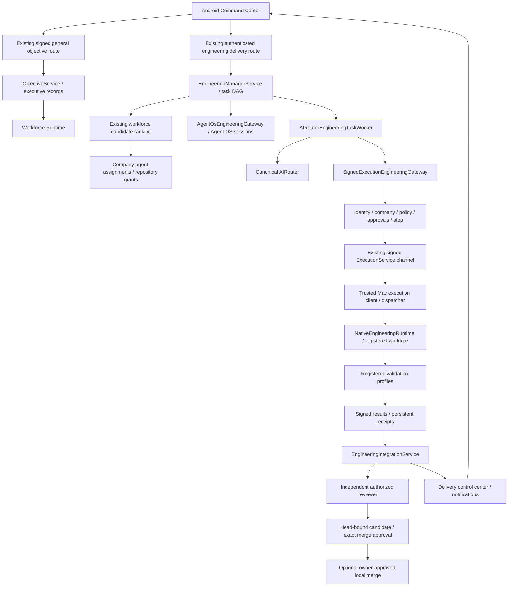

# System integration map

## The two objective paths

General objectives already have signed Android operations: `AlexaRepository.createObjective` → `AlexaApiService.mobileObjectiveCreate` → `/api/v1/device/objectives` → `ObjectiveService.create`. They persist reviewable executive goals/plans/projects. Activation uses Workforce Runtime. This does not automatically create an engineering delivery for an arbitrary “build” brief.

Engineering has its own existing product path: `AlexaViewModel.createEngineering` → `AlexaRepository.createEngineering` → `/api/engineering-deliveries` → `EngineeringDeliveryService.create` → `EngineeringManagerService.create`. This route uses authenticated owner/company, origin, CSRF and transport-network guards. The current Android engineering request is ordinary `EngineeringCreateRequest` JSON, not a signed device envelope. The client checks a trusted registration, but that local check does not substitute for server-side device signature verification. Neither observation authorizes replacing existing endpoints or joining services through a shortcut.

The diagram describes composition, not an accepted live run. Engineering uses workforce ranking and assignments but owns its task graph; it is inaccurate to invent one generic workforce task record for every engineering task. Company-scoped Agent OS sessions provide lifecycle/context identity and do not grant execution.

## Ownership and dependency spine

| Boundary                        | Existing owner and source                                                                                 | Persistent/control responsibility                                                                  |
| ------------------------------- | --------------------------------------------------------------------------------------------------------- | -------------------------------------------------------------------------------------------------- |
| Phone state                     | Android `AlexaViewModel`, `EngineeringScreen`, `AlexaRepository`, `ForegroundSyncController`              | Current company, bounded cache, explicit owner controls and foreground refresh                     |
| Authentication and scope        | `identity/service.ts`, `identity/security.ts`, `companies/context.ts`, `companies/scope.ts`               | Owner/session/device, signed nonce, company membership and lifecycle                               |
| Delivery and project continuity | `engineering-delivery/service.ts`, `session-service.ts`, PostgreSQL stores                                | Objective linkage, feature/check progress, retry/blocker/evidence projection                       |
| Plan and scheduling             | `engineering-orchestration/service.ts::EngineeringManagerService`                                         | Dependency DAG, task attempts, model tiers, atomic lease/generation and recovery                   |
| Workforce and identity          | `workforce-runtime/service.ts`, `agent-workforce/service.ts`, `agents/os-service.ts`                      | Candidate selection, assignments, manifest/context isolation, runtime session linkage              |
| Reasoning                       | `engineering-orchestration/ai-worker.ts`, canonical AIRouter                                              | Bounded proposals, provider failures, model-attempt evidence; no autonomous approval               |
| Governed operation              | `engineering-orchestration/signed-gateway.ts`, `execution/service.ts`, `engineering-runtime/transport.ts` | Finite operation binding, authority, queue, signatures, scope verification and results             |
| Mac effect                      | `electron/execution/execution-client.ts`, `dispatcher.ts`, `engineering-runtime/runtime.ts`               | Verify server envelope, registered roots/profiles, native effect, cancellation and signed result   |
| Review/integration              | `engineering-integration/service.ts`, `ai-reviewer.ts`, `evidence.ts`, `merge-action.ts`                  | Combined checks, independent review, stale-head rejection, exact approval and merge reconciliation |
| Reporting                       | `engineering-delivery/service.ts`, `notifications/service.ts`, Android foreground/push handling           | Canonical status/evidence, bounded notification, company-safe display                              |

The full per-transition register is [transition-register.json](evidence/transition-register.json). Paths there are repository-relative and were checked for existence. Exact runtime event ownership varies: an engineering task event, Agent OS event, Workforce event and execution audit are related records, not interchangeable receipts.

## Current signed draft ingress

The backend now also registers `POST /api/v1/device/engineering-drafts`. Its shared strict operation reaches `EngineeringDraftService`, existing policy and transactional delivery/manager creation, returning only an inert DRAFT/NOT_STARTED result. No arrow from this adapter reaches a worker or native transport. Android's current engineering UI has not yet been wired to it. Legacy auto-driving delivery creation remains a separate existing flow; it cannot activate the new immutable draft markers.
