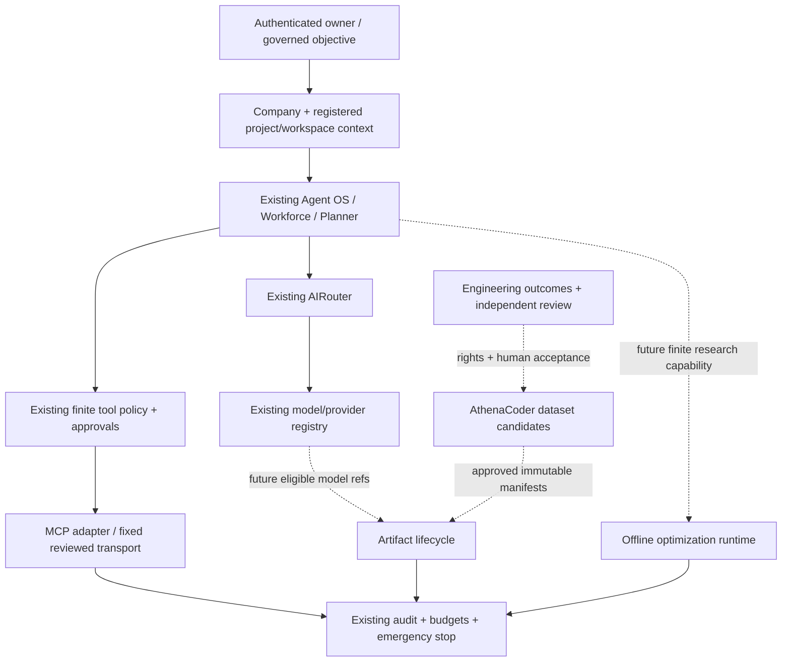

# Cross-foundation architecture and decisions

> Program version 0.1 · 2026-10-26 · INTERNAL REVIEW DRAFT
> Only MCP-1A is authorized for implementation in this run. Other foundations are designs and acceptance plans.

Solid arrows show existing composition or the selected MCP slice; dotted arrows are proposed later integrations. No direct model-to-tool, dataset-to-promotion or solver-to-native-execution shortcut is permitted.

## ADR-001: reusable control plane

Reuse existing owner/session/device identity, company context, registered workspace IDs, integration permissions, tool metadata, policy evaluation, audit and private transport checks. New domain records reference these IDs. Agent Society role names and MCP descriptions are advisory metadata, not permissions. This avoids four competing notions of identity, trust and approval.

## ADR-002: narrow local compatibility

Pin MCP revision `2025-11-25` and official TypeScript SDK `@modelcontextprotocol/sdk@1.32.2` (MIT; Node >=18 package metadata). [Current protocol documentation](https://modelcontextprotocol.io/docs/2026-07-28/learn/versioning) describes `2026-07-28`; its lifecycle differs. The older final handshake revision fits this slice's explicit initialization requirement. SDK v2 is evaluated as a later migration, not installed alongside v1. No current-revision/universal conformance claim is made.

Use SDK protocol handling with a bounded source-owned stdio transport, rather than expose SDK process launch configuration to clients. Only a fixed Node executable and bundled diagnostic server are selectable inside server composition. Refuse remote URLs, caller executable/arguments/environment, roots, sampling, elicitation and server-requested authority. Bound bytes before SDK parsing, not just after deserialization.

## ADR-003: project scope and persistence

For MCP-1A, a registered readable workspace is the existing project-resource boundary. Company grant + exact workspace ID + active signed device/session are intersected. No new organization/project registry is introduced. Persistent configuration/grants use existing integration/governance stores; discovery/session state is ephemeral. Existing audit and policy records persist decisions. No new table or production in-memory fallback is needed. Migration `0118_mcp_local_fixture_provider.sql` adds `mcp_local` to the existing finite provider CHECK constraint. It preserves all existing values and grants no permissions.

## ADR-004: artifacts versus inference descriptors

Future MODEL-1 extends `AIModelRegistry` through an artifact provenance/review layer rather than replace it. Artifact IDs/checksums, dataset/evaluation lineage and promotion approvals are durable; weights reside outside ordinary metadata. AIRouter consumes only an approved healthy endpoint/model descriptor selected by existing role/privacy/economics policy. A research artifact never registers itself into production routing.

## ADR-005: offline science first

Future CODER-1 uses accepted and rights-approved engineering references; no source-code harvest by default. QUANTUM-1 uses exact/heuristic classical binaries on bounded synthetic instances with an independent verifier. No training or quantum runtime is added in MCP-1A.

## Cross-foundation interface proposal (not implemented here)

| Reference                     | Required binding                                                                               | Consumer and authority limit                                 |
| ----------------------------- | ---------------------------------------------------------------------------------------------- | ------------------------------------------------------------ |
| AcceptedEngineeringExampleRef | owner/company/repository/task/result, human acceptance and rights-review versions              | Dataset pipeline may inspect only approved bounded content   |
| DatasetManifestRef            | immutable content hash, split policy/version, rights and privacy classification                | Training/evaluation job request; no deployment authority     |
| ModelArtifactRef              | immutable weights/adapter hash, base lineage/license, dataset/training config refs             | Model lifecycle validation; no automatic AIRouter enrollment |
| EvaluationReportRef           | artifact/data/code/config hashes, environment, actual verification and human acceptance        | Human promotion decision; training loss alone insufficient   |
| ApprovedServingBindingRef     | existing provider/model IDs, reviewed endpoint/resource, approval expiry, health/version       | AIRouter eligibility subject to existing policy/economics    |
| McpToolBindingRef             | registered server/tool/schema digest, company/workspace, source-owned risk, permission version | Finite governed tool route only                              |
| OptimizationExperimentRef     | validated instance, generator/seed/config hashes, runtime, verifier report and baselines       | Research evidence only; no production allocation changes     |

All boundaries use shared strict Zod schemas when implemented. Distinct domain refs must reject cross-company substitutions and stale versions. Use the existing PostgreSQL/unit-of-work pattern for durable transitions; never rely on IDs as proof of authorization.
