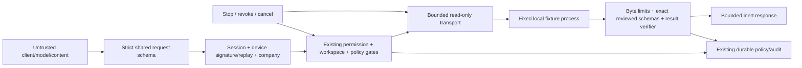

# Security and threat model

> Program version 0.1 · 2026-10-26 · INTERNAL REVIEW DRAFT
> Only MCP-1A is authorized for implementation in this run. Other foundations are designs and acceptance plans.

## Identity, trust and data flows

The HTTP caller cannot supply identity/trust/risk, server URL, executable, arguments/environment, permission or approval state. Signed envelope payload is validated, but signature alone grants no tool scope. Session, device, membership, company lifecycle, workspace permission, integration grant, source-owned tool metadata and stop state are rechecked at meaningful boundaries. Read-only policy uses its existing session baseline; strengthening overrides cannot be bypassed.

MCP-1A reads only static fixture diagnostics; no repository contents, native effects, customer data or external credentials enter the child. Existing signed native execution is unchanged. Zero paid provider spend is distinct from free unlimited resources: deadline, bytes, concurrency and request-rate limits bound local work.

## Threat/acceptance matrix

| Threat                                | Required mitigation and test                                                                                                                 |
| ------------------------------------- | -------------------------------------------------------------------------------------------------------------------------------------------- |
| Prompt injection / malicious metadata | Remote descriptions and text never become instructions; accept only reviewed finite schemas/structured status and return source-owned labels |
| Schema poisoning                      | Exact reviewed schema match; reject external refs, extra properties/tools, unsupported feature/schema versions before call                   |
| Process/SSRF escalation               | Fixed internal Node/fixture entry only; no caller command/env/cwd/URL; remote transport not reachable                                        |
| Secrets in child/logs                 | Minimal child environment; no inherited NODE_OPTIONS/credentials; no stdout/stderr payload logging or raw error reflection                   |
| Missing/spoofed principal             | Existing cookie identity, exact origin/CSRF, trusted device and verified signed envelope with nonce/expiry                                   |
| Cross-company/project                 | Existing company context and company-scoped integration/workspace stores; deny absent context and foreign IDs                                |
| Permission/approval weakening         | Source-owned risk + existing policy; no public tool registration; reject stronger approval unmet                                             |
| Revocation/stop race                  | Recheck before connect/discover/call and before returning success; poll/cancel bounded active operation; stale result suppressed             |
| Timeout/transport failure             | Overall deadline, abort notification/transport teardown, normalized error; never success or automatic retry                                  |
| Replay/duplicate                      | Existing signed nonce replay rejects before dispatch; one active operation per service plus bounded rate; no side-effect retries             |
| Flood/buffer exhaustion               | Bound per-message/total bytes/messages, discovery/tool counts, outbound bytes and deadlines before parsing                                   |
| Audit outage                          | Required start/decision/outcome audit failures suppress execution/success; no arguments, output, tokens or raw errors in events              |
| Shutdown/process orphan               | Close active clients; SIGTERM then bounded SIGKILL fallback and awaited exit; no detached process                                            |
| Training leakage (later)              | Rights, acceptance, privacy filters, hash/near-duplicate components and repo/time holdouts before reviewed dataset materialization           |
| Malicious model artifact (later)      | Immutable checksums, non-executable safe serialization, lineage/license checks and no caller paths/pickle loading                            |
| Self-promotion (later)                | Independent human review, exact artifact/evaluation/deployment digest, existing recent-auth workflows                                        |
| Optimization resource abuse (later)   | Bounded variable/iteration/time limits, finite solver IDs, no code/config evaluation and independent result verification                     |

## Persistence, audit and revocation

Reuse existing PostgreSQL-backed audit, policy, integration permissions and workspace/device/session records. No new MCP persistence adapter is introduced for the fixed fixture. The additive provider CHECK migration 0111 is required; no existing allowed provider or security check is removed. Ephemeral sessions contain only request linkage and controllers, not approval authority. After restart a fresh call rechecks persistent grants and rediscovers; no stale discovery or response cache is trusted.

Existing PostgreSQL acceptance must use an explicit disposable test database. MCP-1A tests need no external effects; add a gated DB integration test for permission/audit persistence where practical. Do not migrate or inspect production as acceptance.

## Rollback and resource policy

Feature defaults disabled and is rejected in production. Disable configuration or revoke company integration/workspace/device permission to deny future calls. Stop/cancel closes active read-only sessions; there are no remote writes to reconcile in this phase. Rolling back code preserves existing audit records; no permanent delete or privilege escalation.

Outstanding: arbitrary third-party local MCP code cannot be assumed safe merely because its tools claim read-only. Future local registration requires reviewed launch profiles and OS containment; remote registration requires SSRF/auth/credential review. MCP-1A's trust is limited to its source-owned fixture, not all local processes.
