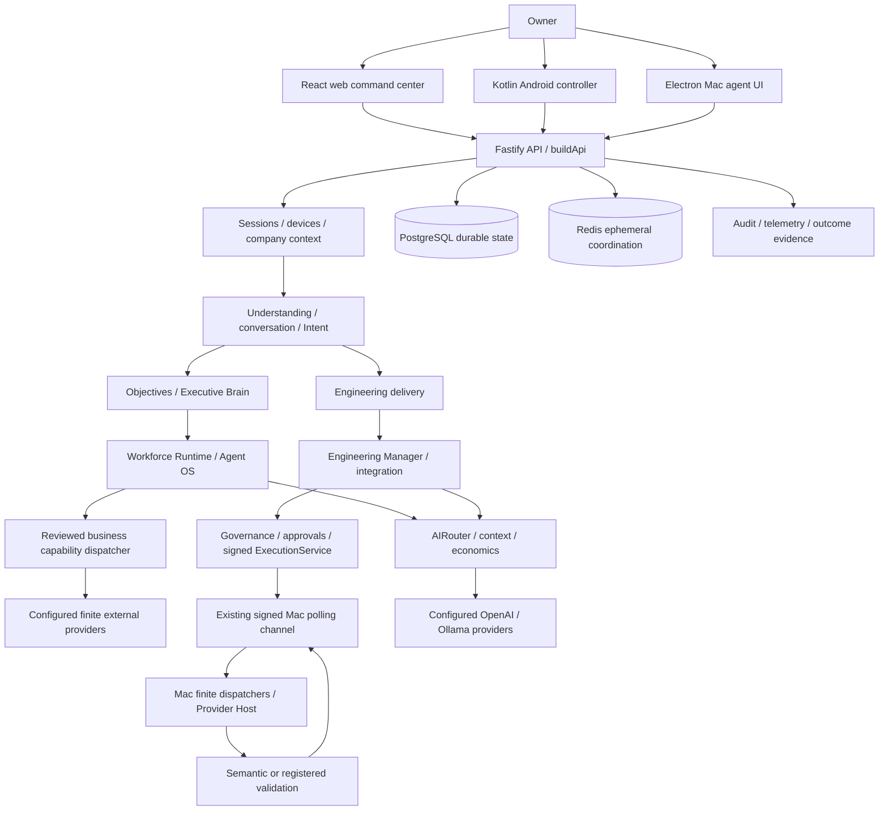
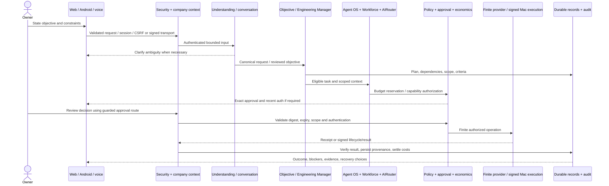

# System architecture and objective lifecycle

> Audit date: 2026-10-26 · CONFIDENTIAL INTERNAL · Review draft v0.1
> Evidence scope: current workspace, including pre-existing uncommitted changes.
> Current implementation, test evidence, and proposed institutional design are distinguished below.

## Runtime topology: current source

Edges show composition, not a guarantee that every request takes every edge. `apps/api/src/index.ts` is production bootstrap; `app.ts::buildApi` is injectable composition used heavily by tests. `apps/api/src/routes/context.ts::ApiRouteContext` is the service surface passed to explicit route registration. A test-created `buildApi` with in-memory stores is not evidence that production storage is in memory.

## Monorepo and entry points

| Unit               | Entry/configuration                                                                                                           | Responsibility and boundary                                                                                          |
| ------------------ | ----------------------------------------------------------------------------------------------------------------------------- | -------------------------------------------------------------------------------------------------------------------- |
| API                | `apps/api/src/index.ts`, `app.ts::buildApi`, `apps/api/tsup.config.ts`                                                        | Node Fastify orchestration and security; Zod request/output contracts; production store and provider composition     |
| Web                | `apps/web/src/main.tsx`, `App.tsx`, `Dashboard.tsx`, `api.ts`                                                                 | React/Vite authenticated UI; no privileged Electron/OS access                                                        |
| Mac                | `apps/mac-agent/electron/main.ts`, `preload.ts`, `execution/dispatcher.ts`                                                    | Electron main-process device identity and reviewed local effects; renderer isolation; fixed IPC                      |
| Native Mac helpers | `apps/mac-agent/native/*.swift`                                                                                               | Reviewed speech capture, active context and semantic interaction; requires macOS permissions and separate acceptance |
| Android            | `apps/android/app/src/main/java/com/alexa/commandcenter/MainActivity.kt`, `ui/AlexaViewModel.kt`, `network/AlexaApiClient.kt` | Kotlin/Compose controller, signed device requests, system biometric integration and foreground sync                  |
| Shared             | `packages/shared/src/index.ts` and domain files                                                                               | Browser-safe Zod contracts; typed identities, proposals, capabilities, results                                       |
| Config             | `packages/config/src/index.ts::parseApiEnvironment`                                                                           | Separate API/client environment validation; production invariants                                                    |
| Deployment         | `Dockerfile`, `deploy/cloud/`, `deploy/tailscale/`, `deploy/engineering-sandbox/`                                             | API packaging and reviewed operator recipes; presence does not prove deployment                                      |
| Corpus             | `personality/`, `apps/api/src/human-understanding/corpus.ts`                                                                  | Structured personality/understanding data, not training weights or execution permission                              |

Root package remains `alexa-control`, package scopes remain `@alexa-control/*`, Android namespace remains `com.alexa.commandcenter`; Athena is the product name. Renaming is not part of this audit. `pnpm-workspace.yaml` includes `apps/*` and `packages/*`; Android is a separate Gradle build. Strict TypeScript includes `noUncheckedIndexedAccess` and `exactOptionalPropertyTypes`. Root CI provisions PostgreSQL and runs migrations, typecheck, lint, tests, build, security checks and format checks; macOS hardware and Android acceptance are additional gates.

## Complete objective lifecycle: several existing routes

1. **Input and identity.** Browser mutations require session authentication, exact origin and CSRF. Signed devices have independent trust/signature/replay checks. `CompanyContextResolver.requireCompany` treats `x-company-id` as a selector, not authority. Voice transcripts and gesture metadata are input, not credentials or approval.
2. **Understanding.** `VoiceRuntimeService.recordTranscript` orchestrates continuity, deterministic routes, contextual answers, executive questions, governed application requests, engineering requests and fallback inference. `HumanUnderstandingService` provides vocabulary, patterns, confidence and clarification. This is a branching implementation, not a single universal LLM planner.
3. **Planning and persistence.** `ObjectiveEngineService.create` creates goal, execution, projects, metrics, strategy and capability-readiness records. `activate` schedules through Workforce Runtime. The legacy `IntentExecutionService.submit` creates inspected command/intent/plan records; its plan alone must not be described as completed execution.
4. **Delegation.** Workforce eligibility precedes ranking. Company assignments, capabilities, lifecycle and budget gates are distinct from skills/reputation scores. Engineering uses registered repository authorization and bounded DAG scheduling in `EngineeringManagerService`; tasks are leased and fenced.
5. **Reasoning.** `AIRouterService` selects registered provider/model candidates under privacy, role, health, cancellation and budget constraints. Structured output is a bounded proposal. `CognitiveContextService` compiles selected context. Neither model prose nor retrieved content can grant authority.
6. **Approval.** `ApprovalService` stores canonical-action digest, expiry, state and session decision; recent-authentication grants come from `SecurityStateService`. A saved command, approved objective, internal credit balance, agent department or model response does not imply permission for its downstream actions.
7. **Effects.** Engineering uses `SignedExecutionEngineeringGateway` and `ExecutionService.createEngineeringExecution`; native semantic actions use the reviewed provider dispatcher and the same signed channel. Business effects use the finite reviewed business dispatcher. Each path has its own prerequisites and must compose central controls correctly.
8. **Verification.** A Mac result must pass device/signature/request/nonce binding before acceptance. Provider receipts require capability-specific reconciliation. Tests and model review answer different questions; neither is a substitute for observing the requested external state. `ObjectiveEngineService.refresh` distinguishes executed completion provenance from manual or legacy attestation and separates execution progress from outcome progress.
9. **Reporting and recovery.** Persisted task, session, execution, validation, metric and audit records feed control centers. Pause blocks new scheduling; cancel and stop propagate through specific runtime controls. Recovery must recheck authority and leases before retry, preserve inspectable work, and reconcile uncertain effects before repeating them.

## Cross-sector dependency and information boundaries

| Producer → consumer              | Permitted information                                                  | Boundary                                                                                    |
| -------------------------------- | ---------------------------------------------------------------------- | ------------------------------------------------------------------------------------------- |
| Memory/company data → AI context | Authorized bounded summaries, provenance and allowed references        | Filter owner/company/project and sensitivity before prompt construction; no secret values   |
| Engineering → research           | Approved architecture/problem summary                                  | Repository grant does not authorize research-agent source access or cloud export            |
| Research → brand/marketing       | Reviewed source evidence and approved factual claims                   | Retrieved text is untrusted; brand review grants no publication authority                   |
| Client Solutions → engineering   | Explicit project brief, test fixtures and scoped repository references | Client scope must not leak into another company or global reusable memory                   |
| Security → operations            | Bounded diagnostic and governance outcomes                             | No raw secrets, private device keys, authentication codes or sensitive arguments            |
| Portfolio → company              | Owner-authorized aggregate or explicit cross-company service request   | Cross-company transfer is explicit and auditable; company selection is not a wildcard grant |

## Architecture alternatives and tradeoffs

Keep the present modular monolith while authority and state machines mature. It permits transaction-local scope checks and auditable service wiring; the large `buildApi` is a maintenance pressure point, but splitting services prematurely would add distributed authorization and failure modes. Later extraction should follow measured load and an explicit security boundary.

Keep PostgreSQL as durable truth and Redis as expendable coordination. Replacing graph or memory stores now would create new isolation and retention duties without demonstrated need. Prefer the current signed Mac channel over a new daemon/socket; it preserves replay/lifecycle controls but requires an online trusted device. A future quota-contained cloud worker could remove that dependency for approved repository work, after containment and credentials isolation are independently accepted.

Company isolation is currently application-enforced across many stores and context propagation paths. Row-level security could add defense in depth, but is a proposal requiring transaction-scoped tenant context, connection-pool hygiene and adversarial testing; this audit does not claim universal RLS.
