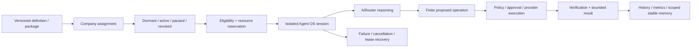

# Agent OS and the AI workforce

> Audit date: 2026-10-26 · CONFIDENTIAL INTERNAL · Review draft v0.1
> Evidence scope: current workspace, including pre-existing uncommitted changes.
> Current implementation, test evidence, and proposed institutional design are distinguished below.

## What an agent is

An agent is a logical software identity with declared specialization, lifecycle, capabilities, context/memory references and runtime records. It is not a person, employee, credential holder, permanently allocated model process, or independent authority. The model is a replaceable provider used during a session. The owner and deterministic governance systems retain decision rights over permissions and consequential effects.

Evidence: `apps/api/src/agents/builtins.ts::BUILT_IN_AGENTS`, `agents/os-service.ts::AgentOsService`, `agents/catalog-model.ts`, `agent-workforce/service.ts::AgentWorkforceService`, and shared Agent OS/workforce contracts. Source-controlled catalogs are exhaustively enumerated in `evidence/agent-catalog.json`: 8 original built-ins, 64 ECC-derived seeds, 40 native workforce seeds, and 13 department templates. These sets have overlapping roles and must not be summed into a claim of concurrently operating workers. Actual owner-created definitions, assignments, sessions and teams were not inspected.

### Original identity roles

| Identity              | Declared role | Intended output                                | Authority limit                                 |
| --------------------- | ------------- | ---------------------------------------------- | ----------------------------------------------- |
| `engineering_manager` | Manager       | Goal analysis, delegation, reporting           | Cannot grant repository or provider permissions |
| `planning_agent`      | Planning      | Implementation plan, dependency/risk analysis  | Plan is a proposal                              |
| `coding_agent`        | Coding        | Patch/refactor/test drafts                     | Mutation needs reviewed execution path          |
| `review_agent`        | Review        | Architecture/maintainability findings          | Review is not approval                          |
| `security_agent`      | Security      | Threat, secret and permission review           | Cannot self-approve security changes            |
| `testing_agent`       | Testing       | Test plan, profile selection, failure analysis | Test success is not release permission          |
| `documentation_agent` | Documentation | README/API/migration material                  | Publication requires human review               |
| `release_agent`       | Release       | Release/changelog/rollback planning            | No deployment authority from title              |

The native catalog covers Executive, Development, Product, Research, Sales, Marketing, Operations, Finance, Customer Success, Quality & Review, and Security specializations. ECC-derived records are pinned to an upstream commit and MIT provenance in `agent-workforce/catalog.ts`; `external-harvest/manifest.ts` explicitly avoids importing an external runtime's authority. Upstream role descriptions are not evidence that every skill has a working tool adapter.

## Runtime model and lifecycle

Manifest/package records separate identity, version and integrity from runtime configuration, permission-profile references, tool references and knowledge sources. `AgentOsService.startSession` packages context and records coordination state; `startIsolatedDelegation` binds manager/specialist, delegation, context/token budget, memory scope, sandbox profile and runtime result attribution. A session's existence does not establish that a tool ran. Engineering's `AgentOsEngineeringGateway` creates a session for each leased task and reconciles older sessions after lease replacement.

Company assignments use assignment UUIDs, distinct from catalog definition IDs and broad role names. `EngineeringRuntimeService` checks repository authorization against the eligible assignment. Revoked/paused assignments cannot be treated as available merely because their catalog definition exists. Dormant identities are activated lazily and do not imply resident model allocation.

## Operating mechanisms and evidence

| Concern               | Current mechanism and symbols                                                                                                    | Verification boundary / gap                                                                                    |
| --------------------- | -------------------------------------------------------------------------------------------------------------------------------- | -------------------------------------------------------------------------------------------------------------- |
| Delegation            | `ExternalHarvestService.prepareDelegation/executeDelegation`; `AgentOsEngineeringGateway.start`                                  | Structured context and session attribution; broad autonomous delegation quality is unmeasured                  |
| Task decomposition    | `ObjectiveEngineService` bounded project strategy; `EngineeringManagerService` deterministic categories/dependencies             | Does not establish general planning intelligence; complex requirements need clarification and human acceptance |
| Dependency scheduling | Engineering ready-node selection, concurrency bounds, leases and fencing; objective predecessor scheduling                       | PostgreSQL crash/concurrency behavior requires disposable-DB integration results                               |
| Collaboration         | `AgentRegistryService.sendMessage/createSharedContext/createConsensus`; `AgentSocietyService.formTeam/startDebate/recordMeeting` | Persisted coordination records, not proof that debate improves correctness                                     |
| Context isolation     | Delegation `memoryScopes`, repository/company gates, bounded typed dependency artifacts; `CognitiveContextService`               | Scope labels alone are insufficient; every retrieval/store query must enforce them                             |
| Model routing         | `AIRouterService.execute/executeStructured`; role mappings in `ai/bootstrap.ts`                                                  | Configured provider availability and live routing remain unaccepted                                            |
| Tool invocation       | Registered capability proposal → signed gateway/provider dispatcher                                                              | No model-selected executable, cwd, environment, public tool registration or generic shell authority            |
| Approval escalation   | `ApprovalService.create/decide/findMatchingApproved`; `SecurityStateService.consumeGrant`                                        | Exact operation and recent authentication where required; voice and gesture never sole factors                 |
| Resource allocation   | `AgentEconomyService.reserve/settle/release`; provider-cost hooks and `AIEconomicsService`                                       | Internal credits are not real money or permission; estimates depend on pricing/configuration                   |
| Failure handling      | Typed categories, bounded retries/escalation, cancellation, recovery scans, reconciliation                                       | Do not retry policy denial or repeat uncertain external effects blindly                                        |
| Persistent state      | Agent, Agent OS, workforce, economy, engineering and society PostgreSQL stores                                                   | Migrations and actual production durability were not inspected on deployment                                   |
| Memory                | Agent cognition plus owner/company/repository-filtered `MemoryIndexerService` context                                            | Summaries and provenance only; no hidden reasoning or unrestricted prompt retention                            |
| Cost attribution      | AI economic context, provider/model/task/agent references, reservations and ledger settlement                                    | Provider invoice reconciliation and systematic missing-usage detection need operational acceptance             |
| Audit                 | Governance writer, task events, signed execution provenance, telemetry links                                                     | Audit fields and retention need periodic secret/disclosure review                                              |
| Review                | Separate eligible reviewer and registered validation sequence for engineering integration                                        | A reviewer title or model confidence is not independent evidence                                               |
| Human supervision     | Objective confirmation, clarification, approval inbox, delivery control center                                                   | Owner-operated implementation; multi-human supervisory roles are proposed                                      |
| Termination           | Workforce cancellation/AbortController, router draining/cancel, execution cancellation and emergency stop                        | Controls are composed across runtimes; stop propagation latency has not been measured                          |

## Shared state versus isolated state

A catalog definition can be reused across companies; an assignment and its authorization must remain company-scoped. Task inputs and dependent artifacts are narrower than the company's whole knowledge store. Stable memory promotion is bounded to validated architecture decisions, API/schema contracts, test expectations and migration notes. Raw conversations, transient failures and speculative model reasoning should not become universal agent memory.

`MemoryIndexerService.retrieveEngineeringContext` checks current company, repository and tagged memory and takes at most twelve safe summaries. `promoteEngineeringFacts` filters allowed artifact types and sensitive content. This is a concrete boundary; it does not establish that every older memory path has equivalent company isolation.

## OS properties and limits

The collective OS-like properties are identity and lifecycle, resource accounting, dependency scheduling, scoped context, registered capability indirection, durable execution state, verification, failure handling and supervision. These properties make delegated work governable independently of one model. They are distributed across services; no single Agent OS class implements the whole operating substrate.

The missing proof is operational: repeatable useful tasks, real-provider/device receipts, tenant adversarial acceptance, cost accuracy, recovery after process death, and measured supervision burden. The correct institutional claim is an implemented foundation for governed delegated intelligence with uneven capability coverage. Autonomous institutional performance, a general cloud workforce and reliable self-directed research remain unestablished.

## Recommended workforce policy

Every assignment should have a named human sponsor, task/scope limits, explicit tool grants, budget, expiration, reviewer and escalation path. Separate competence evaluation from authorization. Disable or narrow agents after repeated verification failures; never let reputation buy permission. Revalidate candidate eligibility after revocation and before every consequential dispatch. Use published evaluation fixtures for capability claims, with separate records for model output quality and real-world operation verification.

## Additional source-controlled role and workflow catalogs

`agents/factory.ts::templateSeeds` defines nine reusable templates: Software Architect, QA Engineer, Research Engineer, Backend Engineer, Frontend Engineer, Database Engineer, DevOps Engineer, Performance Engineer and Security Engineer. These templates overlap catalog roles; they are not nine additional resident processes. `AgentSocietyService` seeds Chief Planner, Engineering Manager, Technical Lead, Security Engineer, QA Engineer and Mentor coordination roles. Exact source metadata, template capabilities and allowed actions are indexed in `evidence/finite-catalogs.json`; prompt bodies are omitted.

`cross-application-workflows/service.ts::builtInTemplates` defines Development Session, Meeting Preparation, Daily Planning, Research Session, Shutdown Routine and Release Deployment. Their semantic steps/dependencies/recovery metadata are indexed in the same file. A template named Release Deployment does not establish a live deployment provider or permission to publish. Older engineering workflows, desktop skills, objective projects and launch-package stages are different orchestration structures; current user-created/saved workflows are UNKNOWN because production records were not inspected.
