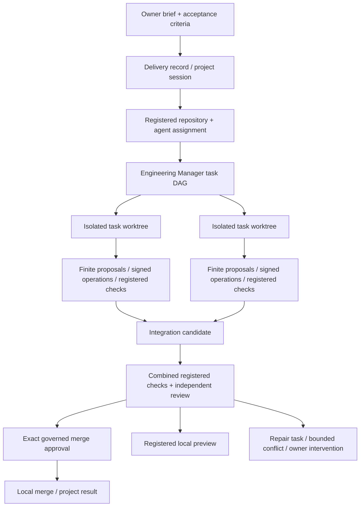

# Product and engineering infrastructure

> Audit date: 2026-10-26 · CONFIDENTIAL INTERNAL · Review draft v0.1
> Evidence scope: current workspace, including pre-existing uncommitted changes.
> Current implementation, test evidence, and proposed institutional design are distinguished below.

## Current engineering stack

The engineering path is a staged system rather than a raw coding-model executor. `EngineeringRuntimeService` owns registered repositories, command profiles, isolated workspace records and finite file/Git operations. `EngineeringManagerService` assigns dependency-ordered tasks. `AIRouterEngineeringTaskWorker` requests bounded structured operation proposals. `SignedExecutionEngineeringGateway` resolves server-owned policy and command data before calling the existing signed `ExecutionService` channel. The Mac implementation is `apps/mac-agent/electron/engineering-runtime/runtime.ts::NativeEngineeringRuntime` (consult the source symbol inventory for exported classes).

`EngineeringIntegrationService` collects validated worktrees into an integration candidate, handles bounded conflict/repair paths, runs combined validation and independent review, and supports governed local merge. `EngineeringDeliveryService` orchestrates initialization or modification, implementation, integration, preview and recovery. `EngineeringProjectSessionService` preserves project continuity. Earlier runtime/manager documents describe earlier phase limits and must be read alongside later delivery code.

## Why each boundary exists

Repository IDs avoid trusting caller filesystem paths. Capability profiles constrain operations; command profiles constrain exact executable/argument templates and validation order. The provider resolves workspace roots locally. Expected content hashes bind patches to the observed file version. Separate worktrees prevent parallel tasks from overwriting one another. Dependency artifacts communicate API/schema/test expectations without replaying whole model transcripts. Integration validation catches interactions that task-local tests cannot.

Workspaces use explicit lifecycle and fenced leases; tasks also have expiring claims. A lease generation rejects an older worker after recovery. Recovery is not permission to reset dirty work. The runtime preserves human edits, rejects unsafe source state for worktree creation, and quarantines approved deletes recoverably. A known static-path defense does not eliminate every hostile-local-process race; OS containment is a separate prerequisite.

## Validation and delivery boundaries

Registered commands run as argument arrays with `shell: false`, bounded output, a minimal environment, timeout/cancellation, and reviewed Docker isolation where required. The dependency preparation path is distinct from offline validation and uses the registered lockfile without lifecycle scripts. No arbitrary command text, cwd, environment, executable path, package installation or project root may be supplied by a model.

The manager may perform several bounded proposal rounds and escalate model tiers after meaningful failures. Neither tier names nor stronger inference grant capabilities. Mutations invalidate prior validation. A successful task needs persisted registered checks; combined delivery needs independent review. A running localhost preview is not a deployed website, a published release, a pushed branch, a created PR, or proof of accessibility/usability.

## Infrastructure and safe operation

| Concern                  | Implementation evidence                                                            | Operational acceptance still required                                                             |
| ------------------------ | ---------------------------------------------------------------------------------- | ------------------------------------------------------------------------------------------------- |
| Build graph              | Root scripts; shared/config/API/web/Mac package manifests; `tsconfig.base.json`    | Clean checkout on pinned Node/pnpm; native macOS and Android builds separately                    |
| API packaging            | Root `Dockerfile`, `deploy/cloud/README.md`                                        | Built image provenance, deployment config, volumes and rollback readiness                         |
| Durable state            | `persistence/database.ts`, migrations, domain PostgreSQL stores                    | Disposable DB migration/concurrency/restart tests; deployed status is UNKNOWN                     |
| Engineering validation   | `validation/service.ts`; Mac `execution/validation-runner.ts`; engineering runtime | Provisioned reviewed local images; live trusted-device acceptance                                 |
| Background coordination  | `durable-execution/scheduler.ts`, governor worker, delivery recovery scans         | Lease expiry, double-worker races, kill/restart, cancellation and idempotency tests on PostgreSQL |
| General artifact sandbox | `durable-execution/sandbox.ts::LocalDockerSandboxProvider.execute`                 | Default real runner is intentionally unavailable until quota containment is reviewed              |
| Telemetry                | `telemetry/service.ts`, `observability/service.ts`; `deploy/otel-collector/`       | Configured collector, bounded retention and no sensitive payload export                           |
| Dependency security      | Lockfile, override policy, CI security scan                                        | Current dependency advisory review is separate from typecheck/build; no inherited old audit score |

`intelligence/worker-service.ts::WorkerService` is queue/counter telemetry, not a durable worker scheduler. Durable execution, workforce leases and engineering scheduling are other implementations. Documentation must not combine these into a fictional single worker fleet.

## Realistic objective examples

**“Add an owner-visible validation history filter to the registered dashboard repository.”** Clarify expected fields and scope; authorize eligible company assignments; decompose API/shared/web/test work; give mutating tasks separate worktrees; require registered checks and integration review; present candidate/preview; merge only through its exact guarded route. This audit did not perform that owner workflow.

**“Create a new site from this brief.”** The delivery initializer supports bounded project scaffolding under a configured development root. A root selected by user/model text is unacceptable. Creating and previewing a local candidate does not authorize domain purchase, public hosting or deployment.

**“Run code in a cloud worker while my Mac is offline.”** The current API hosting and artifact contracts are insufficient to promise this. The real general sandbox refuses execution. Return the blocker; do not fall back to unsandboxed code or a new shell endpoint.

## Engineering division acceptance proposal

For each workflow retain: owner-approved criteria, repository/base commit, assignment and capability profile, scoped context references, task graph, exact approvals, signed execution IDs, check results, reviewer independence, candidate diff, merge outcome, cost and unresolved limitations. Run at least normal, dependency-conflict, denied-policy, revoked-device, cancelled, expired-lease, provider-timeout and restart cases in a disposable environment. Define usefulness with the owner; never infer a production benchmark from unit fixtures.
