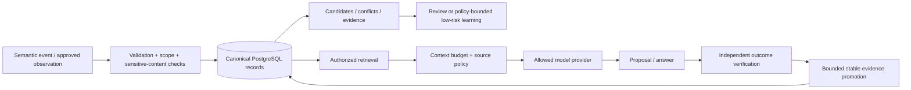

# Intelligence, memory and learning

> Audit date: 2026-10-26 · CONFIDENTIAL INTERNAL · Review draft v0.1
> Evidence scope: current workspace, including pre-existing uncommitted changes.
> Current implementation, test evidence, and proposed institutional design are distinguished below.

## Model-independent institutional continuity

Athena stores structured context and decisions outside a model session so useful knowledge can survive model replacement. The important separation is between **context**, **inference**, **authorization**, and **verified outcome**. An embedding, preference, personality trait or confident model answer can influence a proposal; none can authorize its execution.

## Current layers

| Layer                               | Why it exists / implementation                                                                                     | Limits and maturity                                                                                                         |
| ----------------------------------- | ------------------------------------------------------------------------------------------------------------------ | --------------------------------------------------------------------------------------------------------------------------- |
| Deterministic understanding         | `human-understanding/service.ts::HumanUnderstandingService` and vocabulary/alias/pattern/confidence services       | Explicit patterns and clarification; no proof of broad language understanding or false-positive rate                        |
| Personality corpus                  | `human-understanding/corpus.ts`, `personality/`, corpus tooling                                                    | Structured runtime records and negative examples, not wholesale prompt authority or a training dataset                      |
| Conversation continuity             | `conversation-continuity/service.ts::ConversationContinuityService`                                                | Bounded reference/proposal state; confirmation remains separate from high-risk authorization                                |
| Core memory                         | `memory/service.ts::MemoryIndexerService`                                                                          | Typed memories, decisions, evidence, graph/timeline and engineering summaries; sensitive-content filtering is bounded       |
| Personal knowledge graph            | `knowledge-graph/service.ts::PersonalKnowledgeGraphService`                                                        | Typed entities/facts/relationships, provenance/conflicts and temporal context in PostgreSQL; no separate graph database     |
| Semantic registry                   | `semantic/service.ts::SemanticRetrievalService`                                                                    | Registered object resolution, aliases and confidence; no implied OS effect                                                  |
| Application/workspace understanding | `application-intelligence`, `workspace-intelligence`, `deep-indexers` services                                     | Some baseline objects are explicit placeholders; live application semantic coverage depends on reviewed providers           |
| Context compiler                    | `ai/context/service.ts::CognitiveContextService`, `AIPromptCompiler`; `sources.ts::createProductionContextSources` | Bounded candidate selection, source requirements, privacy and token limits; test fixture context is not live content        |
| AI provider/router                  | `ai/bootstrap.ts::createCanonicalAIServices`, `ai/router/service.ts::AIRouterService`                              | Deterministic bypass, role/capability/privacy/health routing, retries and cancellation; actual configured models unknown    |
| AI economics                        | `ai/economics/service.ts::AIEconomicsService`                                                                      | Pricing, estimates, policies, reservations, settlement and overrides; not an invoice accuracy benchmark                     |
| Preference learning                 | `learning-engine/service.ts::LearningEngineService`                                                                | Evidence thresholds, review, decay/conflict and reversible low-risk auto-application; never trusted-device/policy authority |
| Reflection                          | `reflection/service.ts::ReflectionEngineService` and automation coordinator                                        | Feedback/calibration, periodic analysis and advisory evidence; no verified general recursive improvement                    |
| Skill evolution                     | `skill-evolution/service.ts::SkillEvolutionService`                                                                | Candidates, specification, validation, benchmark/shadow/canary, promotion and rollback records                              |
| Memory Studio                       | `memory-studio/service.ts::CognitiveQueryService`                                                                  | Read model over source stores with archive/pin/retention controls and safe export; no second memory database                |

### Vector retrieval: an important distinction

`intelligence/retrieval-service.ts::RetrievalService.hybridSearch` rejects `mode: "vector"` with `VECTOR_RETRIEVAL_UNAVAILABLE` because the legacy memory store lacks the compatible document-vector contract. Its returned mode is keyword and its vector score is zero. A pgvector column or an “embedding” UI does not establish that this older route performs semantic retrieval.

A newer company-data path **does contain** vector search: `company-data/postgres-store.ts::PostgresCompanyDataStore` builds an authorized materialized subset with owner, company, allowed scopes, entity types, sensitivity and embedding version before cosine-distance ranking. Migration `0086_phase_25_4_company_information_plane.sql` creates `company_semantic_documents` with vector(1536) and an HNSW index. This is implementation evidence, not acceptance of a live embedding pipeline or retrieval quality. The two paths must have separate claim records and tests.

## Provider composition and local intelligence

`ai/bootstrap.ts::createAIRuntime` registers OpenAI and Ollama providers and environment-selected role mappings for FAST_INTERPRETER, GENERAL_REASONER, WRITER, CODER and DEEP_REASONER. Additional roles/types in shared contracts do not establish a configured provider. A LiteLLM adapter exists under `ai/providers/litellm.ts`; baseline bootstrap registration must be verified separately before claiming it is active.

`local-ai/registry.ts::LocalModelRegistry` defines `gemma3:4b` with local interpretation/conversation/extraction roles. This describes a model choice, not proof of downloaded weights, available GPU/RAM, latency, multimodal support in the deployed path, or local accuracy. `local-ai/service.ts::LocalAIService` is explicitly a deprecated administrative compatibility facade; production inference routes through canonical AIRouter. The old local runtime must not silently become a second inference authority.

AIRouter turns RESTRICTED or LOCAL_ONLY data policy into local-only routing and forbids cloud escalation. Paid inference requires a valid economic reservation via `createCanonicalAIServices`. Context availability and model capability are separate gates. Unknown provider health, missing pricing, unavailable model or failed required context must produce a bounded error/clarification rather than an invented result.

## Memory lifecycle and information boundary

Learning policy code sets candidate/suggestion thresholds, high confidence requirements and decay. Explicit owner teaching can create a strong preference; it still grants no tool permission. High-impact model/locality/business decision categories require review. Private mode and scope checks must apply to ingestion, retrieval, promotion, export and telemetry, not just the UI.

Passwords, credentials, raw audio/camera data, unrestricted DOM/Accessibility dumps, raw provider prompts, private reasoning and sensitive action arguments must remain outside cognitive records and publications. Secret patterns are a defense, not proof that every possible secret can be detected. Memory export needs a classification review even when a serializer passes tests.

## Evaluation and improvement proposals

Build separate versioned suites for deterministic intent safety, clarification quality, source-grounded answering, retrieval authorization, retrieval relevance, memory conflict handling, context omission and provider fallback. Record exact corpus/model/configuration versions, allowed data, latency, cost, human judgments and failures. Keep task correctness distinct from authorization correctness.

AthenaCoder, model training and distillation are UNKNOWN as named current systems. A future program needs explicit dataset rights/consent, secret exclusion, train/test separation, held-out evaluation, resource budget, reproducibility, regression gates and deployment approval. Do not relabel the personality corpus or agent catalog as proprietary learned intelligence.
