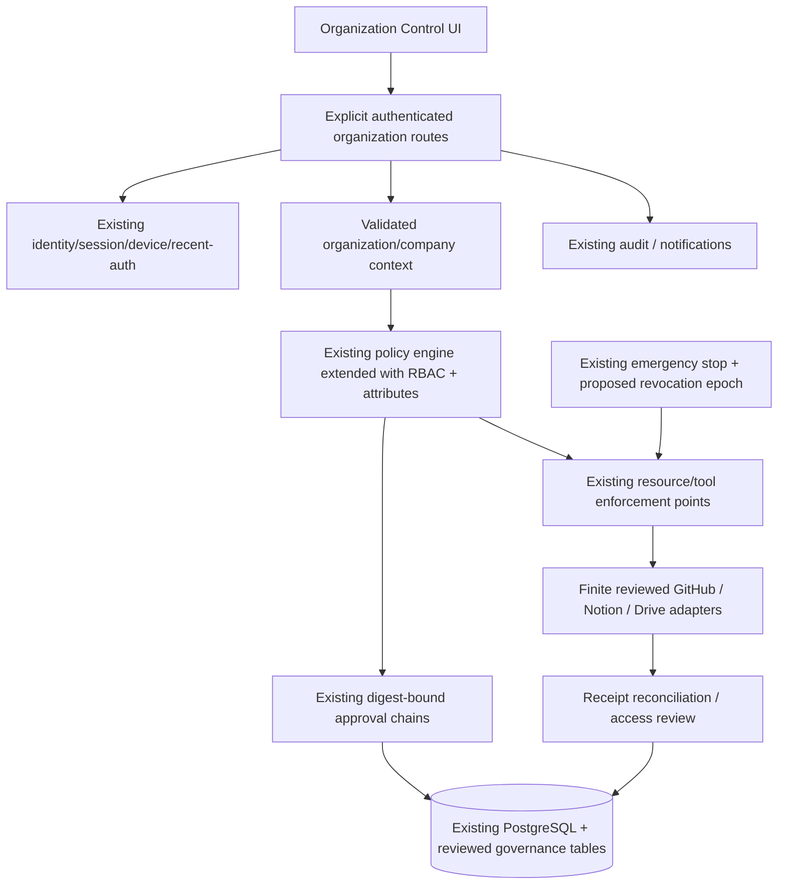

# Athena Organization Control: proposed design

> Audit date: 2026-10-26 · CONFIDENTIAL INTERNAL · Review draft v0.1
> Evidence scope: current workspace, including pre-existing uncommitted changes.
> Current implementation, test evidence, and proposed institutional design are distinguished below.

## Status, purpose and reuse boundary

**Design proposal only.** No application, schema migration, credential change or permission change is implemented by this audit. The proposed application makes human collaboration and institutional clearance inspectable while reusing Athena's authenticated sessions/devices, shared Zod contracts, company scope, deterministic policy/risk, digest-bound approvals, recent authentication, audit, notification and emergency-stop systems.

The present company model is owner-operated; Agent Society organizations are advisory coordination records. Do not turn society membership into security authority or create a second user database. The first implementation must decide how organization membership maps to existing owner/company IDs and legacy records before granting any new human access.

## Architecture proposal



The PDP produces a decision; resource services are enforcement points and must check current policy before reads, exports and effects. The application is a governance control plane, not an execution bypass. External access changes require a reviewed finite capability and separate authorization. Initial releases should produce reviewable desired-state plans before enabling adapters that change external permissions.

## Identity and tenancy model

- Reuse existing authenticated human identity; introduce a typed principal reference for HUMAN, AGENT_ASSIGNMENT and narrowly reviewed SERVICE identity. Resolve references server-side. Agents remain sponsored company assignments, not browser login users or autonomous approvers.
- An Organization is the institutional governance container. A Company remains the existing execution/data isolation boundary. Use explicit organization–company bindings; no automatic global access by matching names or ownership. Agent Society organizations remain linked read models, never inherited grants.
- Divisions describe mandates. Projects bind bounded deliverables/resources and classification. Teams collect principals for scoped grants. Team membership creates no permission until an explicit role binding exists.
- External collaborators require verified human enrollment, named sponsor, exact project, allowed resource subset, expiry and clearance. Invitation acceptance does not itself enroll a trusted device or produce recent authentication.

## Proposed relational domain model

All rows require UUID identity where appropriate, version, timestamps and server-resolved organization/company scope. Composite foreign keys prevent cross-tenant references. Existing IDs are references, not duplicated identity/trust records.

| Proposed table                      | Principal fields / invariants                                                                                                                 |
| ----------------------------------- | --------------------------------------------------------------------------------------------------------------------------------------------- |
| `org_governance_units`              | `id`, accountable owner reference, name, status, policy version, revocation epoch; no implicit global-company scope                           |
| `org_company_bindings`              | organization ID + existing company ID + binding status; unique binding policy explicitly reviewed                                             |
| `org_principal_memberships`         | organization, existing human principal or agent-assignment reference, sponsor, state, starts/expires, version; exactly one principal kind     |
| `org_divisions`                     | organization, canonical sector ID, lead reference, mandate version; no permission implied                                                     |
| `org_projects`                      | organization/company, division, lifecycle, sponsor, classification, approved repository/workspace references                                  |
| `org_teams`, `org_team_memberships` | organization/project, principal, membership validity and version; no transitive wildcard membership                                           |
| `org_role_definitions`              | reviewed role ID/version, finite action set, scope kinds, authority ceiling; cannot modify prohibited actions                                 |
| `org_role_bindings`                 | principal/team, role version, exact resource scope, purpose, time window, approval reference, revocation epoch                                |
| `org_clearances`                    | principal, classification ceiling, compartments, approved purpose, expiration, approver; cannot override project scope                        |
| `org_document_records`              | opaque document ID, classification/compartments, source hash/version, steward, retention, approved disclosure version; no secret bodies       |
| `org_resource_bindings`             | finite kind, existing repo/workspace/tool or external registered resource ID, company, permission ceiling, health                             |
| `org_access_requests`               | requester/sponsor, canonical change digest, target scope/version, reason code, status, existing approval-chain reference                      |
| `org_approval_chain_steps`          | request, ordered reviewer-role reference, required independence/recent-auth, decision reference; no agent/voice sole approval                 |
| `org_invitations`                   | hash of one-time invitation token, target identity constraint, sponsor, scope ceiling, expiry, consumed/revoked state; no raw token persisted |
| `org_access_reviews`                | review batch, scoped grant snapshot/version, reviewer, decision, due/closed times and evidence references                                     |
| `org_external_access_receipts`      | adapter/resource/binding, desired-state digest, external revision, status, reconciliation time; no credentials                                |
| `org_revocation_events`             | principal/scope, previous/new epoch, stop/cancel references, acknowledgement summaries                                                        |

Audit records remain in the existing audit system; secret values remain in the deployment secret manager. Do not persist passwords, invitation raw tokens, raw provider dumps, client documents or action arguments in audit metadata. Soft archive replaces permanent deletion. Export must be bounded and separately authorized.

## Authorization semantics

Effective permission is the **intersection** of authenticated principal state, active organization/company membership, project/resource scope, finite role action, contextual restrictions, classification/compartment clearance, device/network requirements, current policy, required approval/recent-authentication, external-binding health and emergency-stop state. Explicit denial wins. Unknown/stale/inconsistent state denies. Role hierarchy may only narrow inheritance; no “division admin implies every tool” rule.

Contextual restrictions include approved purpose, time window, device trust, deployment transport, resource sensitivity, provider/account, project lifecycle and current revocation epoch. Clearances authorize reading classes of information only inside an already granted project; they do not grant execution. An agent cannot approve a request, change its grant, invite a collaborator or mutate authority through a model response.

Use version-fenced writes and canonical change digests. Approval must bind requester, organization/company/project, principal, finite role/actions, exact resources, validity, clearance and relevant policy/resource versions. Altering any bound field invalidates approval. Recheck immediately before external permission dispatch and before returning restricted data. Never accept caller-computed identity, risk, approval strength, device/network trust or policy result.

### Example role-action matrix (proposal)

| Role               | Read classified project docs        | Propose changes                     | Approve access                                             | Change external grants                | Execute project tools              |
| ------------------ | ----------------------------------- | ----------------------------------- | ---------------------------------------------------------- | ------------------------------------- | ---------------------------------- |
| Viewer             | Only permitted class/compartment    | No                                  | No                                                         | No                                    | No                                 |
| Contributor        | Scoped permitted documents          | Own project drafts                  | No                                                         | No                                    | Separate explicit capability grant |
| Project steward    | Scoped records + access metadata    | Scope/classification proposals      | Only delegated low-risk tier, never own request            | Separate reviewed approval/capability | Separate grant                     |
| Security reviewer  | Minimum review evidence             | Security findings                   | Required independent security step where configured        | Separate exact capability             | No default execution               |
| Organization owner | Policy-authorized institution scope | Governance changes                  | Human approval subject to prohibited rules and recent auth | Approved finite adapter only          | No blanket executor                |
| Agent assignment   | Authorized bounded context          | Task artifacts/capability proposals | Never                                                      | Never self-grant                      | Existing governed dispatch only    |

## API proposal

Prefix `/api/org-control/v1`. These routes are **not existing endpoints**. All validate shared strict Zod request/response schemas, authenticate identity, resolve organization/company context, apply authorization, paginate and bound response size. Cookie mutations require CSRF and exact trusted origin; sensitive grants/exports/revocation recovery require recent authentication according to server-owned risk. Signed device routes reuse current envelopes and replay defenses rather than accepting raw asserted trust.

| Method/path                           | Request / response contract                                                                                                                     | Governance behavior                                                                  |
| ------------------------------------- | ----------------------------------------------------------------------------------------------------------------------------------------------- | ------------------------------------------------------------------------------------ |
| `GET /organizations`                  | Cursor/limit → authorized summaries only                                                                                                        | No inaccessible organization counts or names                                         |
| `GET /organizations/:id`              | ID → filtered mandate/status/version                                                                                                            | Membership/clearance checked                                                         |
| `GET /organizations/:id/projects`     | Cursor/filter → scoped project summaries                                                                                                        | Filter before totals and ranking                                                     |
| `POST /organizations/:id/projects`    | Name, division ID, company ID, sponsor ref, classification → proposed project/version                                                           | Binding validation and required human review                                         |
| `GET /projects/:id/access`            | Pagination → authorized grant summaries                                                                                                         | No secret identity or unrelated membership disclosure                                |
| `POST /projects/:id/access-requests`  | Principal ref, role ID/version, finite resource refs, starts/expires, purpose, expected versions, idempotency key → request/digest/review steps | Compute effective ceiling/risk server-side                                           |
| `POST /access-requests/:id/review`    | Decision, expectedVersion, optional rejection reason and recent-auth grant ref → updated review state                                           | Existing approval workflow, independence and digest checks                           |
| `POST /projects/:id/invitations`      | Identity constraint, grant ceiling, expiry, sponsor, idempotency key → invitation reference                                                     | Review required; one-time raw token delivered only via separately approved mechanism |
| `POST /invitations/:id/accept`        | One-time token, authenticated identity → pending membership result                                                                              | Hash comparison, expiry, exact target, replay denial; no credential logging          |
| `POST /grants/:id/revoke`             | Expected version, reason code, idempotency key → revocation state                                                                               | Immediate internal deny; cancel/fence work and queue external reconciliation         |
| `POST /access-reviews`                | Finite scope, due date, reviewer refs → review batch                                                                                            | Snapshot current grant versions; bounded batch size                                  |
| `POST /access-reviews/:id/decisions`  | Grant IDs/versions, retain/narrow/revoke → accepted decisions                                                                                   | Missing/new versions require re-review; no silent renewal                            |
| `POST /documents/:id/export-previews` | Audience and target classification → redacted preview manifest                                                                                  | Preview grants no export/publish permission                                          |
| `POST /exports/:id/approve`           | Exact preview digest and expected version → approval record                                                                                     | Existing approval/recent-auth policy; no automatic publication                       |
| `GET /audit`                          | Authorized bounded filters → sanitized event links                                                                                              | Auditing is itself scoped                                                            |
| `POST /emergency-revocations`         | Principal/project/org reference, expected version, reason, idempotency → epoch/cancellation acknowledgements                                    | Only reviewed authority; preserve audit and recovery controls                        |

Example access proposal (illustrative IDs, no grant created):

```json
{
  "principalRef": { "kind": "HUMAN", "id": "00000000-0000-4000-8000-000000000101" },
  "roleId": "project-document-reviewer",
  "roleVersion": 1,
  "resourceRefs": [
    { "kind": "DOCUMENT_COLLECTION", "id": "00000000-0000-4000-8000-000000000201" }
  ],
  "purpose": "Review the approved research replication protocol",
  "startsAt": "2026-11-01T00:00:00Z",
  "expiresAt": "2026-11-08T00:00:00Z",
  "expectedProjectVersion": 3,
  "idempotencyKey": "review-invitation-example-1"
}
```

Errors use bounded code/message/request ID: `AUTH_REQUIRED`, `SCOPE_UNAVAILABLE`, `POLICY_DENIED`, `APPROVAL_REQUIRED`, `RECENT_AUTH_REQUIRED`, `VERSION_CONFLICT`, `EXPIRED`, `REVOKED`, `BINDING_UNAVAILABLE`, `EXTERNAL_RECONCILIATION_PENDING`. Avoid confirming another tenant's object existence. Responses expose effective grants and reasons appropriate to the requester, never sensitive action payloads.

## Invitation, review and offboarding state machines

Invitation: DRAFT → REVIEW_REQUIRED → APPROVED → ISSUED → ACCEPTED or EXPIRED/REVOKED. Acceptance creates only the reviewed scoped membership, subject to active versions; higher requested scope requires a new request. No automated external message is part of this design implementation.

Access request: PROPOSED → VALIDATED → WAITING_APPROVAL → APPROVED → INTERNAL_APPLIED → EXTERNAL_PENDING → VERIFIED, or DENIED/EXPIRED/REVOKED/RECONCILIATION_REQUIRED. Internal access must remain denied if external state is unknown where the external grant would be required. Do not label a permission change successful from an adapter's accepted request alone.

Offboarding: mark principal/membership revoked and increment epoch transactionally; deny new reads/effects immediately; invalidate session/grant caches; revoke relevant sessions and recent-auth grants; fence/cancel pending work; reconcile outstanding effects; remove finite external grants through reviewed adapters; preserve audit, reviewed artifacts and retention obligations. External provider outage must not undo local revocation. Report residual external access as an incident with owner visibility.

## External integration strategy and tradeoffs

GitHub: registered installation/repository/team IDs and least-privilege app permissions; reviewed repository/team membership operations, branch protections and receipts. Never accept arbitrary repository URL or organization administration as a generic action.

Notion: explicitly allowlisted database/page IDs and document-release mappings; do not synchronize the confidential source corpus wholesale. Store source hashes, approved disclosure version and external revision. Drive: registered shared-drive/folder/document IDs, explicit reviewer groups, revision preconditions and bounded exports; default no public-link sharing.

For all: secret-manager references, company-specific bindings, finite actions, exact approvals, durable idempotency, external revision checks, reconciliation and revocation. Start with read-only inventory and desired-state previews. Existing connector descriptors are reusable metadata; missing live permission adapters are real implementation work.

Git-managed documents are easiest to review/version but require a reader application for selective access. Notion/Drive are approachable collaboration surfaces but add external ACL drift, link-sharing and reconciliation risk. Keep Git/approved registry canonical; external copies carry release version and may not silently update approved claims.

## Threat model and trust boundaries

Browser/agent input is untrusted; authenticated principal and company membership are server-owned. External connector discovery/results are untrusted evidence; they cannot supply authority. The database is durable truth but every query needs scope, and pooled connections must not leak tenant context. The model receives only authorized bounded context and never raw grants/secret material as permission. The worker must recheck revocation/approval before effects; a valid lease alone is insufficient.

Primary attacks: invitation theft/replay; cross-organization ID confusion; role-inheritance escalation; agent sponsor impersonation; stale clearance/cache; approval digest substitution; reviewer collusion/self-approval; timing races with revocation; external ACL drift; shared-link leakage; malicious document instructions; export of inaccessible counts/snippets; audit tampering or sensitive metadata. Mitigate with hashed single-use tokens, composite scope keys, deny precedence, least privilege, purpose/expiry, version fences, independent review, current authorization and exact external receipts. Preserve a bounded offline emergency path if a provider fails.

## UX information architecture

Overview → organizations/companies → divisions → projects → teams/principals → effective access → pending requests/invitations → document clearance/export preview → reviews → external bindings/drift → audit → emergency controls. Each resource page shows “why this principal has access,” exact scope, expiry, source role/version, approver and last reconciliation. Unknown state is visibly denied, not a green badge. Separate “reviewed internally” from “verified externally.”

Design for keyboard/screen-reader use and ordinary pointer access. Voice/gesture may navigate registered controls but never approve sensitive grants or emergency recovery. An invitation preview must explain the actual resources the recipient receives before approval.

## Phased implementation and acceptance plan

1. **Domain/identity review:** resolve owner/company/organization mapping and legacy data; specify shared Zod contracts and denial tests. Gate: no cross-tenant references or role-derived implicit authority.
2. **Read-only control surface:** show existing identity, grants, tools, approval and audit references. Gate: scoped reads/counts/export previews and no external writes.
3. **Internal requests/reviews:** versioned grants, clearances, expiry and existing approval integration. Gate: current-auth/digest/independence checks, transaction rollback and audit atomicity.
4. **Collaborators/offboarding:** reviewed enrollment/invitations, project roles, expiry/review jobs and revocation epochs. Gate: no replay, privilege inheritance, stale-cache access or queued-work continuation.
5. **External adapters:** one provider at a time, read-only drift first, then separately approved finite reversible grants in test accounts. Gate: independent receipt reconciliation and revocation under provider outage.
6. **Operational acceptance:** disposable PostgreSQL races/restarts, read-only deployment inspection, authorized device testing and restore drills. Gate: human/security sign-off before enabling production collaboration.

Test deny paths for unknown principal/company/role/tool, malformed schema, foreign resource, expired invitation/grant/approval, tampered digest, wrong purpose/session/device, missing recent auth, stop active, provider unhealthy and forbidden operation. Test races: approve versus edit, grant versus revoke, duplicate acceptance, dispatch versus epoch increment, worker replacement and external timeout. Test authorization before vector search/ranking, cache reads, exports and aggregate counts. Confirm audit contains no raw tokens/secret arguments, permanent deletion fails, and neither voice nor agent can approve. No production credentials or mutations are needed for these fixture and disposable-environment stages.
