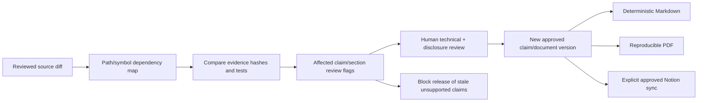

# Documentation as code: source and review design

> Audit date: 2026-10-26 · CONFIDENTIAL INTERNAL · Review draft v0.1
> Evidence scope: current workspace, including pre-existing uncommitted changes.
> Current implementation, test evidence, and proposed institutional design are distinguished below.

## Current deliverable and proposed automation

This audit creates versioned source **files**, not a running documentation service. `02_CAPABILITY_REGISTER.json` is the canonical audit capability snapshot; `evidence/` holds source hashes, declarations, routes, migrations, catalogs and sanitized validation evidence. No CI job, PDF generator, Notion writer or permission synchronizer is installed by this audit. The design below should be implemented as a separately reviewed repository change.

## Canonical information model

Use stable human-readable capability IDs independent of display names. Keep source evidence, test execution, maturity, disclosure and approval as separate concepts. A module can have code and passing unit tests while its live provider remains unavailable. A public claim must specify exactly which acceptance scope supports it.

Proposed source tree:

```text
docs/institutional-source/
  schema/                 # reviewed Zod/JSON Schema definitions
  sectors.json            # mandates, owners and proposed/current status
  capabilities.json       # stable capability IDs and dependency/evidence links
  evidence.json           # path/symbol/hash and accepted test artifacts
  publications.json       # sections, audience, claims and disclosure manifest
  reviews/                # append-only approvals and supersession references
  editorial/              # human-authored institutional prose
  generated/              # reproducible unapproved review reports
```

The existing audit is the seed material, not another runtime capability registry. Documentation claims reference Athena's existing registered tools/providers/capabilities by ID; they never register executable tools or alter permissions. Organization sector definitions map explicitly to company departments and Agent Society IDs, while retaining `PROPOSED` when no actual institutional unit has been approved.

### Required capability metadata

Identity/name/sector/subsystem; purpose and user behavior; implementation mechanism and entry points; shared schema symbols; API/store/table/migration dependencies; agents/models; environment/provider/binding prerequisites; security/approval/verification rules; maturity and exact acceptance scope; source evidence IDs; tests and run manifests; limitations/gaps; suggested improvement; documentation owner; confidentiality; revision; review status/approver/date; affected publication claim IDs; source watch paths and review expiry.

UNKNOWN is mandatory where implementation/specification cannot be established. Separate explicit deprecation from merely old documentation. Separate “API/schema exists” from “provider is executable,” “fixture verified” from “device/provider verified,” and “approved internal source” from “approved public claim.”

### Proposed strict schema approach

Reuse shared types for actual source capability/provider/risk identifiers; introduce documentation-specific metadata in a reviewed docs package only when automation is authorized. External evidence import and synchronization payloads must be strict Zod boundaries. Illustrative fragment, **not code installed by this audit**:

```ts
const Maturity = z.enum([
  "IMPLEMENTED_AND_VERIFIED",
  "IMPLEMENTED_NOT_VERIFIED",
  "PARTIALLY_IMPLEMENTED",
  "ARCHITECTURE_ONLY",
  "RESEARCH",
  "PLANNED",
  "DEPRECATED",
  "UNKNOWN",
]);
const EvidenceReference = z
  .object({
    id: z.string().min(3).max(160),
    path: RegisteredRepositoryRelativePathSchema,
    symbol: z.string().max(200).optional(),
    sha256: z.string().regex(/^[a-f0-9]{64}$/),
    kind: z.enum([
      "SOURCE",
      "UNIT_TEST",
      "DB_ACCEPTANCE",
      "DEVICE_ACCEPTANCE",
      "PROVIDER_ACCEPTANCE",
      "APPROVED_DESIGN",
    ]),
    scope: z.string().min(1).max(2000),
  })
  .strict();
```

`RegisteredRepositoryRelativePathSchema` is a proposed reviewed docs boundary, not an existing export asserted by this report. Reject traversal, absolute paths and blocked/secret paths; do not accept arbitrary file reads. VERIFIED claims require a current successful acceptance artifact matching scope/version plus reviewer approval. Unit coverage is sufficient only for the explicitly bounded behavior the test actually establishes.

## Source change → review workflow



1. Compare the review base and proposed commit using fixed repository metadata operations, never model-produced shell text. Resolve watched paths and exact symbols to evidence/capability IDs.
2. Mark changed hashes, moved/missing symbols, schema/route changes, provider coverage and failed/skipped acceptance as review triggers. Transitive dependency impact is explicit and bounded; unrelated source changes need not invalidate every publication.
3. Produce a deterministic impact report: capability, changed evidence, affected claim/section, accountable reviewer and required action. An AST detector can reduce noise but cannot decide semantic truth from a diff.
4. Keep approved public text immutable in its version. A source change flags review; it does not rewrite or republish claims. Draft suggestions may be generated into a separate review artifact only.
5. Reviewers decide whether evidence changes a claim, narrow its scope, downgrade maturity, add a gap or leave the wording valid. Every decision cites source/acceptance and rationale. Prohibited/secret content blocks release.
6. Only an approved manifest can generate a new release bundle. Missing approval, unknown owner, invalid classification or unresolved contradiction fails closed.

Do not make every source change block ordinary code work indefinitely. A documentation-impact acknowledgement can accompany an internal code merge while release of the stale public claim remains blocked. Security-critical authority changes require their own normal code-review gates regardless of editorial status.

## Generated Markdown and publication pipeline

Generate capability matrices, API/schema indexes, implementation-versus-declaration coverage, test exclusions and evidence appendices from approved data. Keep mission, explanations and operational judgment human-edited. Render current/proposed distinctions visibly; avoid a single ambiguous “supported” badge.

Proposed PDF pipeline: fixed approved Markdown inputs and template → locally rendered Mermaid SVG → pinned Pandoc/Typeset engine and embedded fonts → accessible PDF checks → link/page/caption validation → secret/disclosure scan → artifact/source hashes and approval manifest. Pin tool versions, avoid remote fonts/images, disable raw HTML/script where possible, and do not execute arbitrary code blocks. Render in an isolated build environment with no production secrets or broad network access.

Alternatives: Pandoc with a pinned TeX engine offers mature typography but larger toolchain and accessibility work; Typst offers a smaller expressive pipeline but needs template/accessibility evaluation. A static documentation site is good for navigation/search, but its publication pipeline still needs approved separate disclosure bundles. Select one after a small rendering proof; no pipeline result is claimed here.

## Proposed Notion synchronization

Git/approved registry remains canonical. An explicit human-approved release manifest selects destination registered page/database IDs and allowed sections. A finite reviewed adapter creates/updates those records using a company-scoped secret reference. Bind approval to content hash, disclosure, destination, external revision and action. Use bounded idempotent operations and reconcile the actual provider version afterward.

Never mirror confidential source evidence to a general workspace by default. External edits become a conflict/review item; do not silently overwrite approved Git claims or import external page instructions as authority. Notion is a publication/collaboration projection, not a new policy or memory database. Google Drive/GitHub exports follow the same reviewed mapping and classification controls. Automatic external messages or writes are not authorized by this audit.

## Review checks and acceptance

Schema: strict validation, stable unique IDs, bounded fields and valid status transitions. References: source path exists, symbol/hash matches, table/API dependencies are traceable. Evidence: success/skips/failures differentiated, fixture versus live scope explicit, no verified claim solely from code presence. Disclosure: no secret/raw prompt/private reasoning/customer material; derived document inherits classification unless released. Ownership: named responsible role and human assignee before approval. Review: exact content/version/destination digest and independent security/scientific review as needed.

Test impact detection on changed/deleted/moved symbols, generated file churn, schema changes, provider removal, test failure/skips and unrelated edits. Test deterministic Markdown/PDF output, broken links, unsupported Mermaid syntax, missing fonts, stale approvals and Notion revision conflicts. Accept sync only in an authorized test workspace with receipt/reconciliation; keep public publishing disabled until that review.

## Initial ownership and review policy proposal

The founder appoints a documentation steward. Subsystem maintainers own factual accuracy; Security/Data stewards own disclosure; research leads own scientific interpretation; founder or explicitly delegated humans approve public institutional commitments. An agent may draft and flag impact but never approve its claims. Review on mapped source change, new evidence, disclosure change and before every release; set time-based freshness thresholds after operational evidence establishes suitable intervals.
