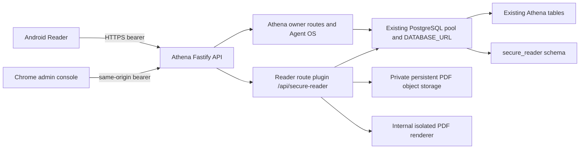

# Secure Reader on the existing Athena API

Status: local integration candidate, **not deployed**. Athena's existing public origin is `https://personalassistant-production-269b.up.railway.app`; the currently deployed `/api/secure-reader/health` returns 404. Do not upload confidential PDFs until a reviewed production renderer and persistent private storage are accepted.

## Architecture and boundaries

`buildApi` registers the Reader plugin only when `SECURE_READER_ENABLED=true`; the default is disabled. The disabled `/api/secure-reader/health` returns 503. When enabled in a non-production fixture, it returns `{"status":"ready"}` only if PDF processing is configured and the Reader tables are queryable. The bootstrap in `apps/api/src/index.ts` passes Athena's existing `database.pool`; it does not create a second `DATABASE_URL` or PostgreSQL pool. `PostgresDatabase` and its TLS policy remain authoritative. Reader SQL explicitly qualifies `secure_reader.*`, so a pooled connection cannot accidentally switch Athena's `search_path`.

Reader bearer tokens authenticate only Reader routes. Athena owner routes still use Athena's owner/session middleware and reject a Reader bearer. Reader users and sessions have no foreign keys to Athena owners, devices, companies, or Agent OS. A Reader administrator is a Reader role only. Browser admin requests use bearer credentials in memory, with exact origin checks; no Reader cookie or Athena CSRF exception is introduced. Static `admin.html` contains no secret. Global Athena host, CSP, CORS, logging redaction, rate limits, and emergency-stop state still wrap the plugin. Missing or active emergency-stop state denies Reader requests. Reader's own IP and per-user rate buckets remain in PostgreSQL. Request logging is disabled for the Reader route prefix to avoid logging upload query metadata.

## HTTP contract

All paths below are relative to `/api/secure-reader`. External request bodies and parameters use the retained Reader Zod contracts in `apps/api/src/secure-reader/contracts.ts`.

| Path                                                                                                                | Method          | Authority                                     | Purpose                                                                        |
| ------------------------------------------------------------------------------------------------------------------- | --------------- | --------------------------------------------- | ------------------------------------------------------------------------------ |
| `/health`, `/ready`                                                                                                 | GET             | Public, safe                                  | Readiness; 503 when disabled or PDF processing unavailable                     |
| `/admin.html`, `/assets/:file`                                                                                      | GET             | Public static UI                              | Admin interface and allowlisted hashed assets; API actions still require ADMIN |
| `/auth/start`, `/auth/finish`                                                                                       | POST            | Invited email and one-time code               | Reader-only session creation                                                   |
| `/session`, `/sessions`, `/sessions/:id`                                                                            | GET/DELETE      | Reader bearer                                 | Session view and revocation                                                    |
| `/reader/documents`                                                                                                 | GET             | Reader bearer and current grant               | Document library                                                               |
| `/reader/tickets`, `/reader/page`                                                                                   | POST            | Reader bearer, document grant, one-use ticket | Authorized watermarked PNG delivery                                            |
| `/admin/state`                                                                                                      | GET             | Reader ADMIN bearer                           | Bounded administration and audit state                                         |
| `/admin/invitations`, `/admin/grants`, `/admin/grants/:userId/:documentId`                                          | POST/DELETE     | Reader ADMIN bearer                           | Invite, grant, revoke                                                          |
| `/admin/documents`, `/admin/documents/:id`, `/admin/documents/:id/preview-ticket`, `/admin/documents/:id/watermark` | POST/DELETE/PUT | Reader ADMIN bearer                           | Upload, version, archive, preview and watermark                                |
| `/admin/users/:id/disable`, `/admin/sessions/:id`                                                                   | POST/DELETE     | Reader ADMIN bearer                           | User and session revocation                                                    |

There is no original-PDF retrieval route or public object URL. Uploads use generated private keys; reader page delivery rechecks session, grant, document version, ticket expiry, and checksum before returning a PNG. Founder documents are always `HIGHLY RESTRICTED` and cannot be granted to a READER. New documents have no grant. The first Reader administrator is created by an offline operator command, never by a public bootstrap endpoint.

## Production activation boundary

The imported Reader production configuration **still rejects production startup unconditionally**, even if S3, TLS mail, and an internal renderer URL are supplied. This preserves the prior security gate until renderer isolation, object storage privacy, and hosted acceptance are demonstrated. The existing Railway service remains the only proposed public server; an internal renderer process would need an independently verified sandbox inside that service or another reviewed arrangement that does not expose a second public origin. No such sandbox or persistent Reader object store was confirmed in this run. The Railway CLI session is unauthorized, so its volume and variables could not be inspected.

The Android client uses the same Athena HTTPS origin at build time and prefixes all calls with `/api/secure-reader`. It checks Reader readiness before restoring a session and retains a first-launch HTTPS origin field as fallback. This does not establish live Android login or viewing while the deployed Reader route is absent.
